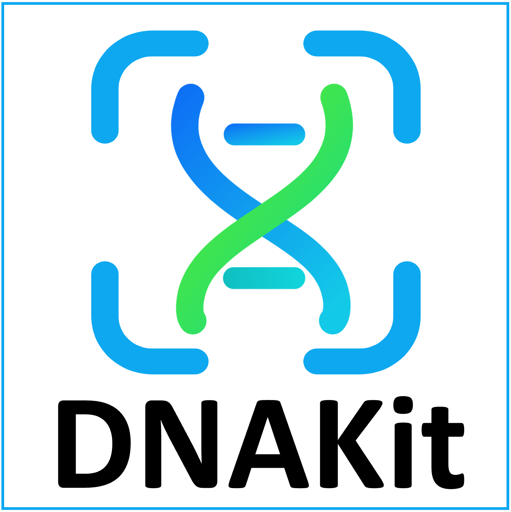
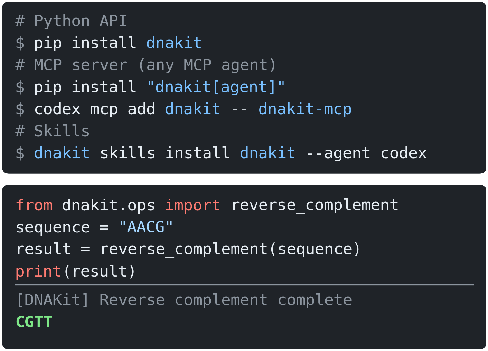
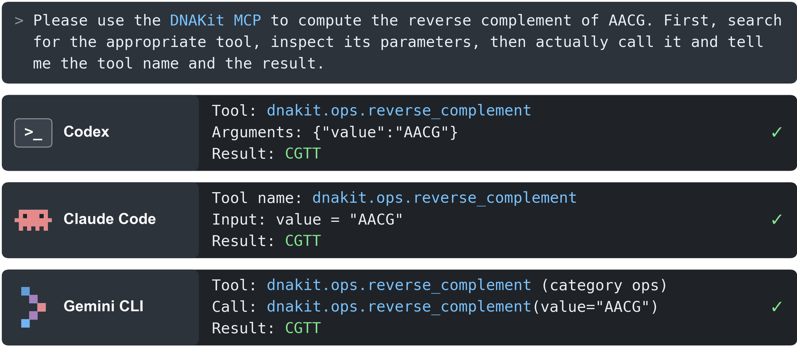
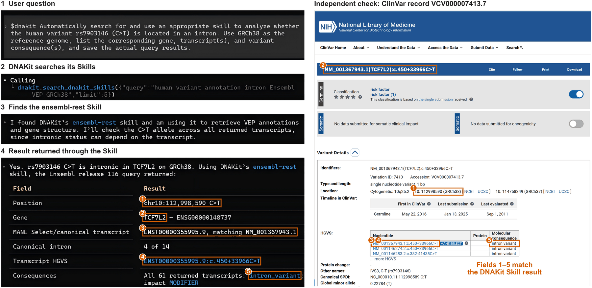
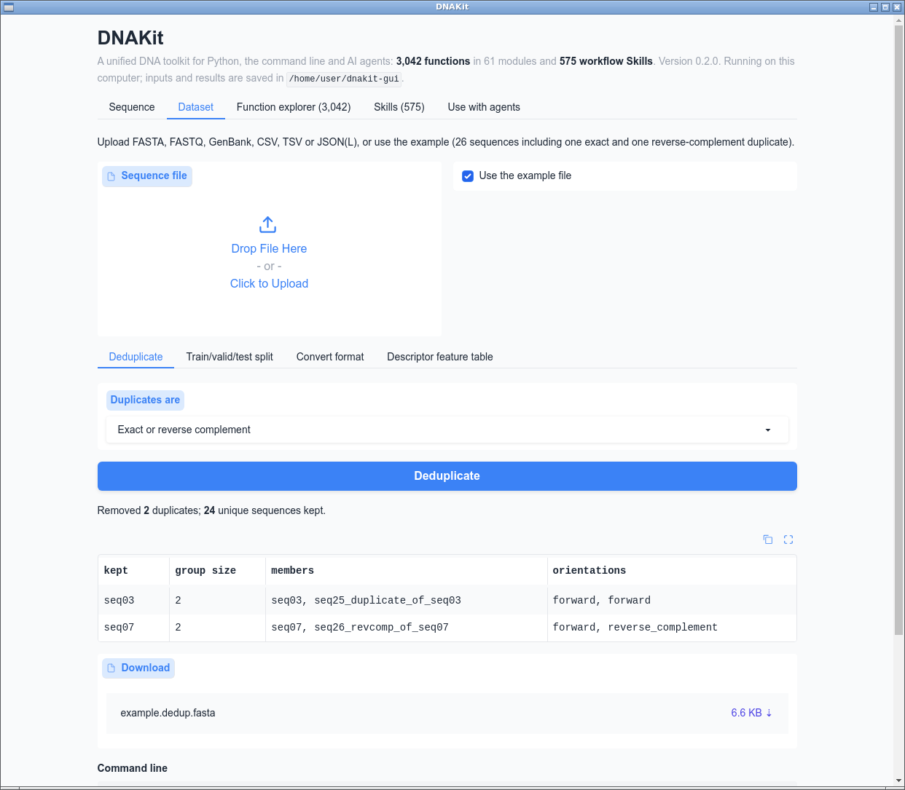

<p align="right">
  <strong>简体中文</strong> | <a href="https://github.com/mapengsen/DNAKit/blob/main/README.md">English</a>
</p>

<p align="center">
  
</p>

<p align="center">
  <a href="https://github.com/mapengsen/DNAKit/actions/workflows/ci.yml">
    
  </a>
  <a href="https://mapengsen.github.io/DNAKit/">
    
  </a>
  <a href="https://www.python.org/downloads/">
    
  </a>
  <a href="https://github.com/mapengsen/DNAKit/blob/main/LICENSE">
    
  </a>
</p>

<p align="center">
  <a href="https://pypi.org/project/dnakit/">
    
  </a>
  <a href="https://github.com/mapengsen/DNAKit/tree/main/packaging/bioconda">
    
  </a>
  <a href="https://github.com/mapengsen/DNAKit/tree/main/galaxy/dnakit">
    
  </a>
  <a href="https://github.com/mapengsen/DNAKit/tree/main/packaging/guix">
    
  </a>
</p>

<p align="center">
  <a href="https://github.com/mapengsen/DNAKit/blob/main/docs/llm_tools/mcp.md">
    
  </a>
  <a href="https://github.com/mapengsen/DNAKit/blob/main/docs/llm_tools/skills.md">
    
  </a>
</p>

<p align="center">
  <a href="https://dnakit.mapengsen.asia">
    
  </a>
  <a href="https://github.com/mapengsen/DNAKit/blob/main/docs/gui.md">
    
  </a>
  <a href="https://github.com/mapengsen/DNAKit/blob/main/docs/gui.md">
    
  </a>
  <a href="https://github.com/mapengsen/DNAKit/blob/main/docs/gui.md">
    
  </a>
</p>

<p align="center">
  <strong>DNAkit: A Comprehensive Toolkit for Efficient DNA Research</strong>
</p>

# DNAKit 是什么？

DNAKit 是面向 DNA 分析的统一工具包。它按同一套规范整合了 284 个现有软件、Web 服务和 Agent 工具集的功能，提供 6,698 个操作；研究者和 AI Agent 用同一套函数，就能完成从数据下载到模型训练的整个流程。定位类似“DNA 领域的 RDKit”。完整的文档、教程和 API 说明见 [mapengsen.github.io/DNAKit](https://mapengsen.github.io/DNAKit/)。

| **6,698** | **12** | **148** | **107** | **48** | **7** |
|:---:|:---:|:---:|:---:|:---:|:---:|
| 操作 | DNA 分析领域 | 文件格式 | 公共数据库 | DNA 基础模型 | 使用方式 |

# 为什么用 DNAKit

- **一套规范，不用逐个适配工具：** 所有操作使用相同的命名、数据格式、返回结果和错误提示，不同软件之间不再需要自己写衔接代码。
- **一次安装，七种用法：** [Python API](docs/llm_tools/python_api.md)、命令行、[网页版](https://dnakit.mapengsen.asia)、[桌面版](docs/gui.md)、[MCP](docs/llm_tools/mcp.md)、[Skills](docs/llm_tools/skills.md) 和内置 [Agent](docs/llm_tools/agent.md) 共用同一套实现，结果一致。
- **为 AI Agent 准备好的 DNA 工具：** 6,120 个操作可通过 MCP 调用，另有 575 个工作流 Skills；同一个请求在 Codex、Claude Code 和 Gemini CLI 中得到相同结果。
- **不写代码也能用：** 网页版打开浏览器即可使用，无需安装；桌面版（`dnakit gui`）支持 Windows、macOS 和 Linux。
- **每一步都可追溯：** 每次操作对应一次明确的函数调用，输入、参数、后端和参考数据库都会记录下来，便于检查和复现。
- **可以自己扩展：** 写一个带类型注解和文档的 Python 函数即可注册为工具；也可以用自然语言描述需求，由 Agent 生成工具，通过检查后注册。

# 能做什么

| 领域 | 操作数 | 例子 |
|:---|---:|:---|
| 数据与数据库 | 692 | FASTA、BAM、VCF、BED 等 148 种格式的读写与转换；NCBI、Ensembl、ENCODE、ClinVar 等 107 个数据库的查询与下载 |
| 序列分析 | 251 | 反向互补、转录与翻译、ORF 查找、k-mer 与序列组成、DNA 描述符 |
| 比对与同源 | 328 | 序列比对、相似度与距离、BLAST 同源搜索 |
| 测序读段与组装 | 566 | 读段修剪与质控、UMI 处理、读段比对、基因组组装 |
| 变异与临床 | 907 | 变异检测、VEP 注释、ClinVar 临床意义、结构变异 |
| 群体遗传与 GWAS | 680 | 群体遗传统计、单倍型与连锁不平衡、全基因组关联分析 |
| 基因与表达 | 1,009 | 基因注释与同源基因、表达与富集分析、单细胞与空间转录组 |
| 调控与表观基因组 | 666 | motif 扫描、峰分析、甲基化、Hi-C 接触矩阵 |
| 进化与微生物组 | 452 | 系统发育树、dN/dS、泛基因组、宏基因组与物种分类 |
| 设计与工程 | 389 | 引物设计、熔解温度与热力学、限制性酶切、Golden Gate 组装、CRISPR 设计 |
| 序列机器学习 | 195 | 数据集去重、聚类与划分，指纹与特征，性质预测模型训练 |
| DNA 基础模型 | 233 | AlphaGenome、Evo 2 等 48 个模型的表征提取、微调与预测 |

DNAKit 还提供生成序列的评价（有效性、唯一性、多样性、新颖性）和可视化（序列文字图、位置高亮、线性与环状 DNA 图、序列比对图）。另有 330 个通用操作（如基础设施和文献检索）不归入上述领域。完整清单见[功能树总览](https://mapengsen.github.io/DNAKit/api/features/function_tree/)。

# 在 Python、AI Agent 和 Skills 中使用 DNAKit

安装一次，同一套函数既能在 Python 代码中调用，也能交给支持 MCP 的 AI Agent 和 Agent Skills 使用。

## Python 包（PyPI）

```bash
pip install dnakit
```

```python
from dnakit.ops import reverse_complement

print(reverse_complement("AACG"))  # CGTT
```

<p align="center">
  
</p>

## 面向 AI Agent 的 MCP 服务器

```bash
pip install "dnakit[agent]"
codex mcp add dnakit -- dnakit-mcp     # Codex
claude mcp add dnakit -- dnakit-mcp    # Claude Code
```

Agent 通过 `search_dnakit_tools` 找到函数，用 `describe_dnakit_tool` 查看参数，再用 `call_dnakit_tool`
运行。同一个请求在 Codex、Claude Code 和 Gemini CLI 中得到相同的结果。详见 [MCP 教程](docs/llm_tools/mcp.md)。

<p align="center">
  
</p>

## Skills

```bash
dnakit skills install dnakit --agent codex    # 或 --agent claude-code、--agent cursor
```

DNAKit 内置 575 个经过整理的 DNA 与基因组学工作流 Skills。收到问题后，Agent 会检索这些 Skills、选出合适的一个，
并返回真实的查询结果。下图中，Agent 用 `ensembl-rest` Skill 注释变异 rs7903146，给出的 5 个字段与 ClinVar
记录完全一致。详见 [Skills 教程](docs/llm_tools/skills.md)。

<p align="center">
  
</p>

# 网页版与桌面版

不写代码也能使用 DNAKit。网页版和桌面版使用同一套界面：单序列工具（描述符、ORF、motif、序列比较）、
数据集工具（去重、训练/验证/测试集划分、格式转换、描述符特征表）、全部 Agent 可调用函数（附等价的
Python 和 MCP 调用），以及 Skills 目录。

**网页版：** 浏览器打开 [https://dnakit.mapengsen.asia](https://dnakit.mapengsen.asia)，无需安装。网页运行在共享 CPU 上，单次调用限时，
不执行写文件、下载模型或调用外部程序的函数。

**桌面版：** 在自己电脑的窗口中运行同一界面，没有上述限制。

| **系统** |  |  |  |
|:---|:---:|:---:|:---:|
| **直接下载** | [](https://github.com/mapengsen/DNAKit/releases/download/desktop/DNAKit-windows-x64.zip) | [](https://github.com/mapengsen/DNAKit/releases/download/desktop/DNAKit-macos-arm64.dmg)<br>[](https://github.com/mapengsen/DNAKit/releases/download/desktop/DNAKit-macos-x64.dmg) | [](https://github.com/mapengsen/DNAKit/releases/download/desktop/DNAKit-linux-x64.tar.gz) |
| **或用 pip 安装** | `pip install "dnakit[gui]"` | `pip install "dnakit[gui]"` | `pip install "dnakit[gui-qt]"` |
| **再用命令打开** | `dnakit gui` | `dnakit gui` | `dnakit gui` |

下载版不需要安装 Python：解压后双击 **DNAKit** 即可（macOS 先把它拖进“应用程序”）。下载版包含界面和
DNAKit 的核心函数；依赖可选软件包的函数（如深度学习模型）需要用 pip 安装。软件没有代码签名，第一次打开
需要确认一次：Windows 点“更多信息”→“仍要运行”；macOS 打开“系统设置”→“隐私与安全性”，点“仍要打开”。

在 PyPI 发布下一个版本之前，pip 安装请从 GitHub 获取：`pip install "dnakit[gui] @ git+https://github.com/mapengsen/DNAKit"`（Linux 用 `gui-qt`）。桌面版在 Windows 上
使用 WebView2，在 macOS 上使用 WebKit；Linux 上使用 GTK WebKit 或 Qt 后端，没有显示器的服务器会改用
浏览器打开。详见[图形界面说明](https://github.com/mapengsen/DNAKit/blob/main/docs/gui.md)。

<p align="center">
  
</p>

# 安装与快速入门

Pypi安装当前版本：

```bash
pip install dnakit==0.2.0
```

如需 VEP、ClinVar、dbSNP、gnomAD、dN/dS 和 Golden Gate
功能，可执行 `pip install "dnakit[external-tools]"` 安装可选后端。

如需让支持 MCP 的 Agent 调用 DNAKit，可执行 `pip install "dnakit[agent]"`，然后在 Agent
中配置 `dnakit-mcp` 命令。

当前源码中的内置 `run_agent()` 还支持按需生成工具、优化说明或兼容修复实现、本地文件结果缓存与断点续跑，以及检索用户指定的知识库目录（RAG）。配置和示例见 [Agent 教程](docs/llm_tools/agent.md#agent-actions)；工具生成与优化要求可写源码检出及显式副作用授权。

当前源码还包含统一的 DNA／基因组学 Skill 目录。先用 `python -m pip install -e "."`
安装本仓库，再用 `dnakit skills search "变异注释"` 搜索，或用
`dnakit skills install dnakit --agent codex` 安装统一入口。
Claude Code、Cursor、MCP 和引用方式见 [Skills 教程](docs/llm_tools/skills.md)。
DNAKit 代码保持 MIT；收录技能保留[各自的许可证和作者署名](THIRD_PARTY_NOTICES.md)。

当前源码还新增了[育种、基因识别、甲基化、DNA 存储与纳米结构接口](docs/api/features/38_genomics_extensions.md)，以及 [外部分析与 MCP 连接](docs/api/features/39_external_genomics.md)。
从本地安装所需依赖，例如 `python -m pip install -e ".[bio-analysis,genomics-genes,agent]"`。
各 DNA 方向的原始项目、作者与尚缺能力见[来源 FAQ](docs/faq/genomics_sources.md)。[335 个补充项目审核](docs/faq/user_catalog.md)逐项记录去重结果、新增接口及未接入原因。

如果需要参与开发，克隆仓库后通过 Conda 创建完整环境：

```bash
conda env create -f environment-dev.yml
conda activate dnakit-dev
```

# 文档

完整文档位于 [DNAKit 文档首页](https://mapengsen.github.io/DNAKit/)，所有功能模块可在 [功能树总览](https://mapengsen.github.io/DNAKit/api/features/function_tree/) 中查看，常见问题见 [FAQ](https://mapengsen.github.io/DNAKit/faq/)。

# 支持与社区

**Github仓库：**

[github.com/mapengsen/DNAKit](https://github.com/mapengsen/DNAKit)

如果有问题、意见或建议，可以先查看：

- [常见问题](https://mapengsen.github.io/DNAKit/faq/)
- [GitHub Issues](https://github.com/mapengsen/DNAKit/issues)

# 更多发布平台

仓库已提供 [Bioconda 与 GNU Guix 配方](https://github.com/mapengsen/DNAKit/tree/main/packaging)
以及 [Galaxy Tool Shed 包装器](https://github.com/mapengsen/DNAKit/tree/main/galaxy/dnakit)。这些文件已固定对应
`0.1.1`；在各平台审核通过前，仍请使用上面的 PyPI 安装方式。

# 更新日志

详细版本更新记录请查看 [CHANGELOG.md](https://github.com/mapengsen/DNAKit/blob/main/CHANGELOG.md)。

# 引用

DNAKit 的项目论文尚未发表。当前版本可引用为：

```text
DNAKit contributors. DNAKit 0.2.0, 2026. https://github.com/mapengsen/DNAKit
```

正式论文发表后，此处将更新为论文引用信息。使用具体算法、数据库或可选后端时，还应引用其对应来源。

当前工作区还提供原生 DNA 编码、生成评价、统计和约束优化，以及可选格式编解码与比对/NGS 专业后端；用法按任务归入[功能教程](docs/api/features/function_tree.md)，依赖与实现约定见[生物信息学说明](docs/faq/bioinformatics.md)。使用 `python -m pip install -e ".[bio]"` 安装。
