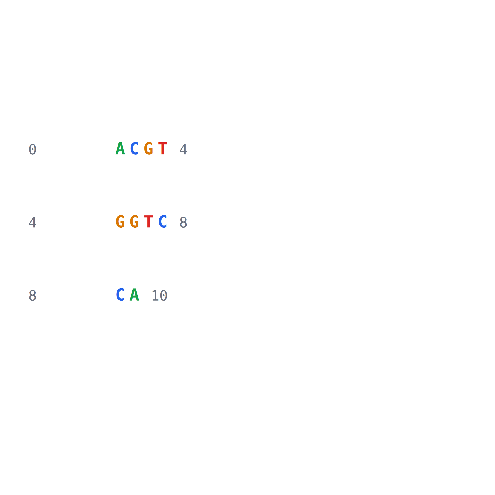
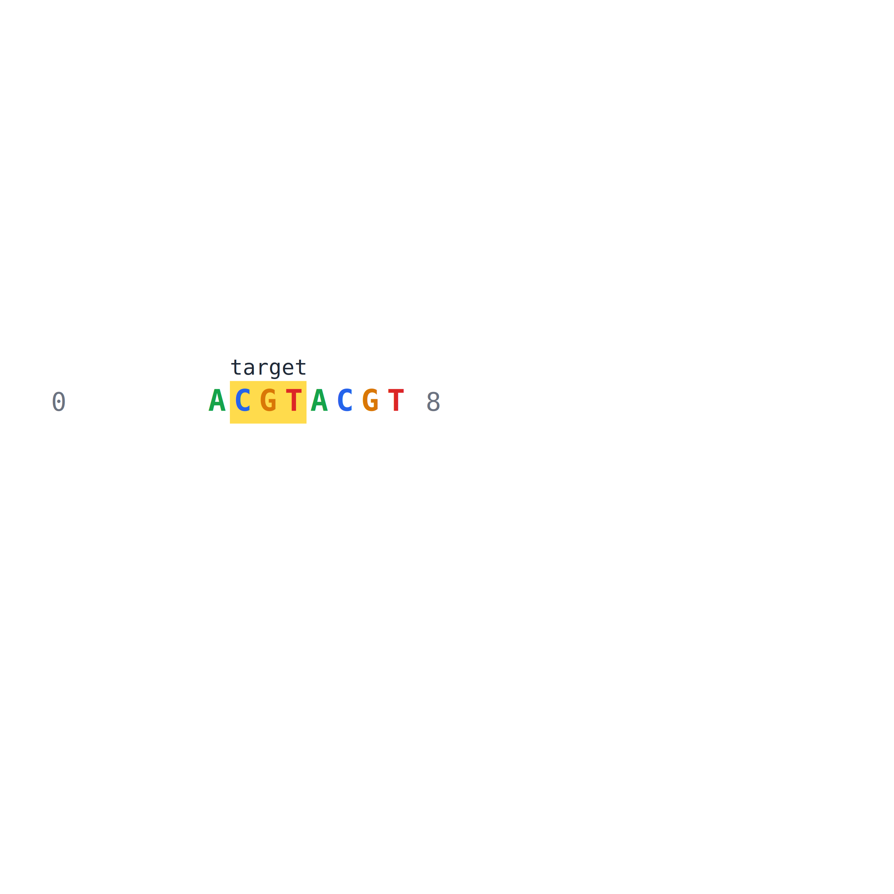
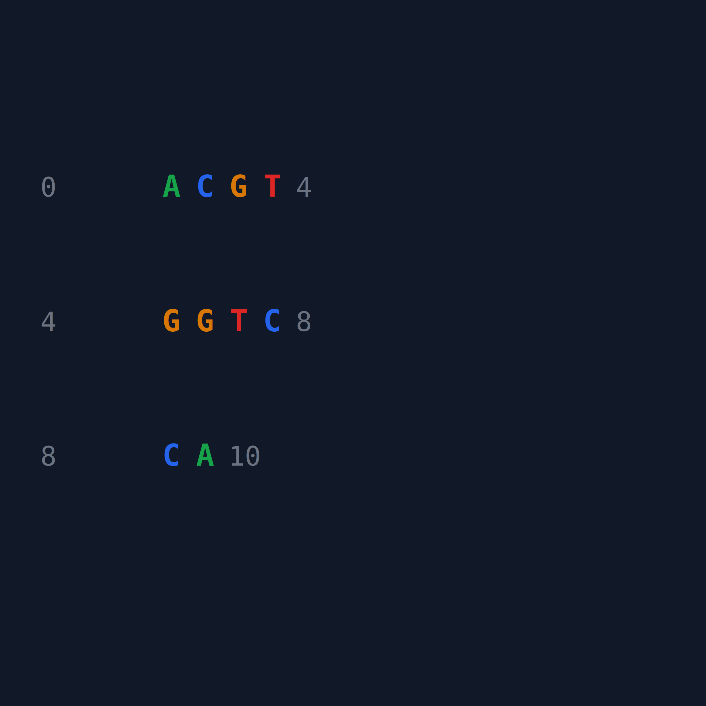
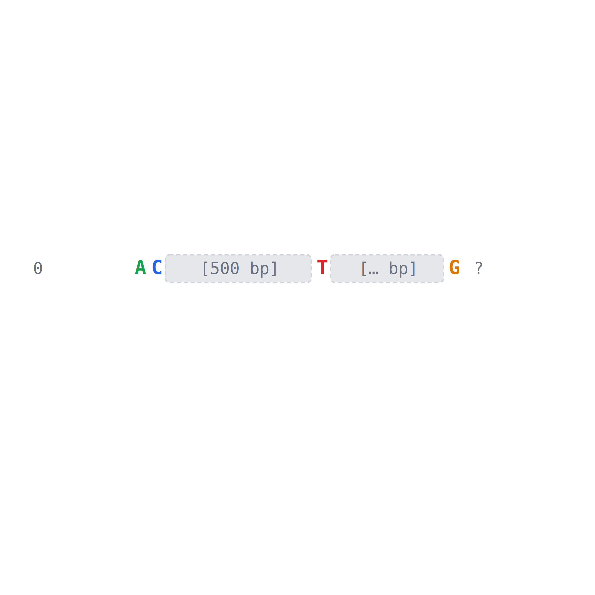
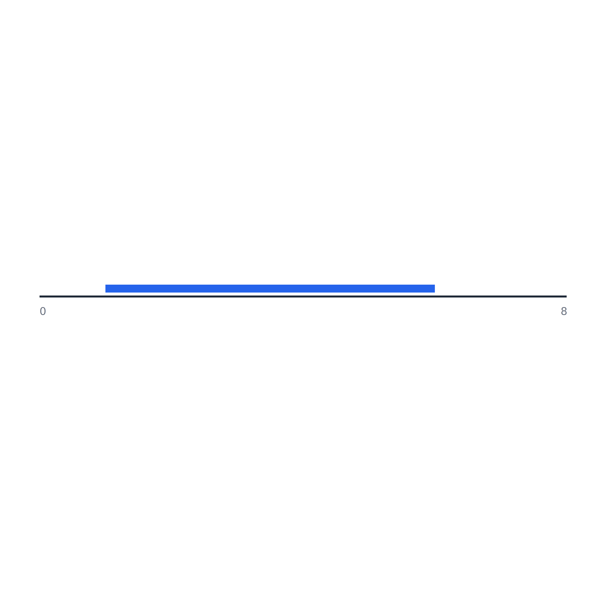
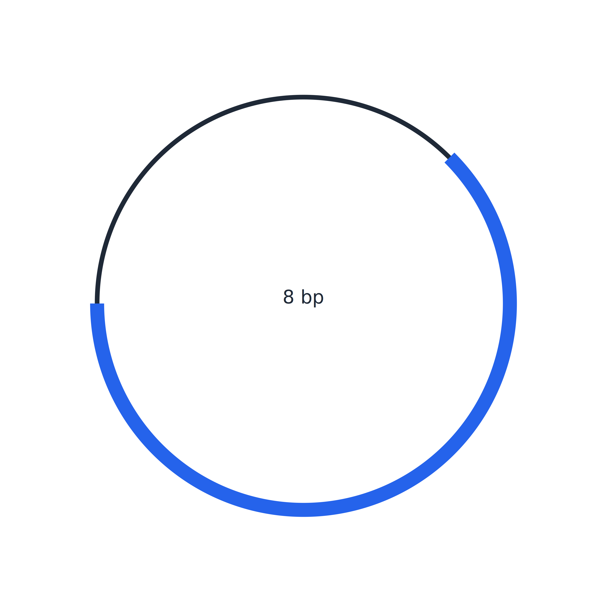
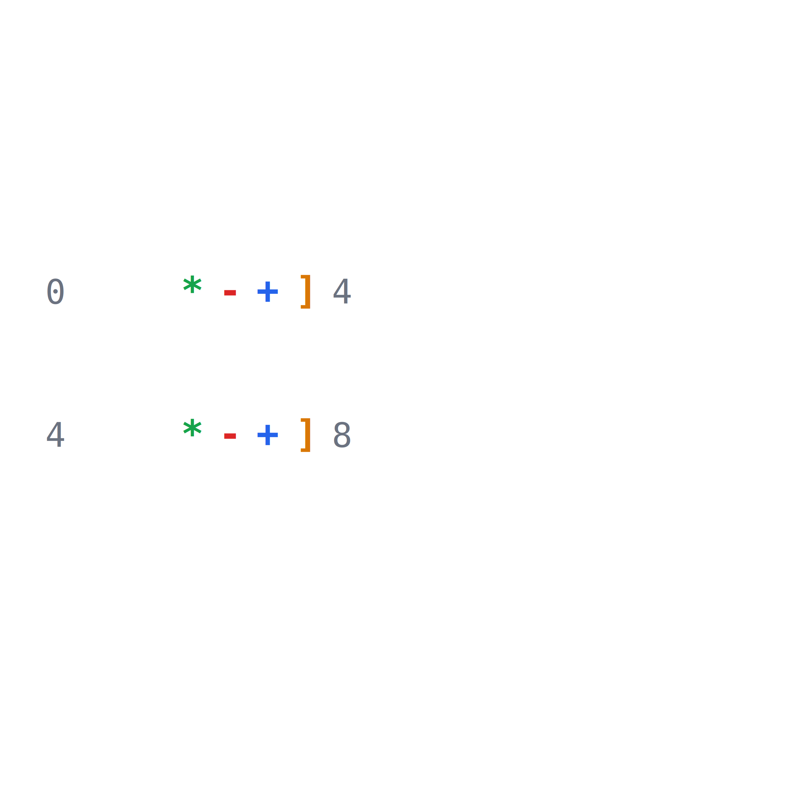
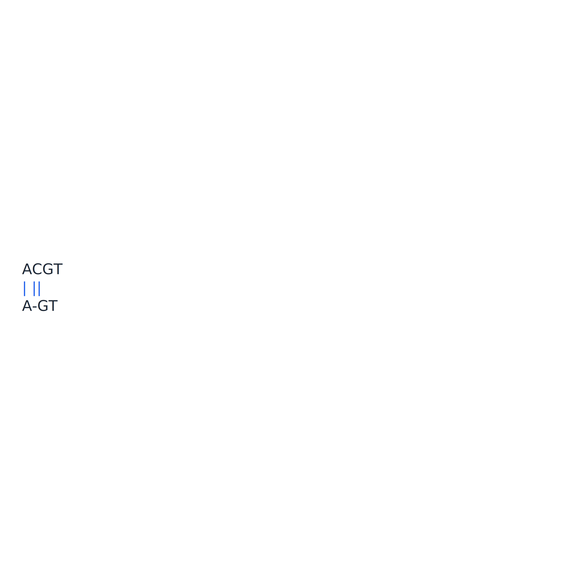
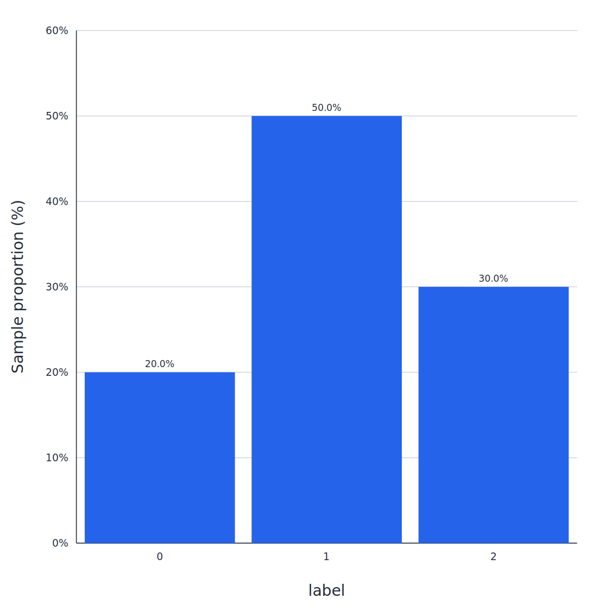
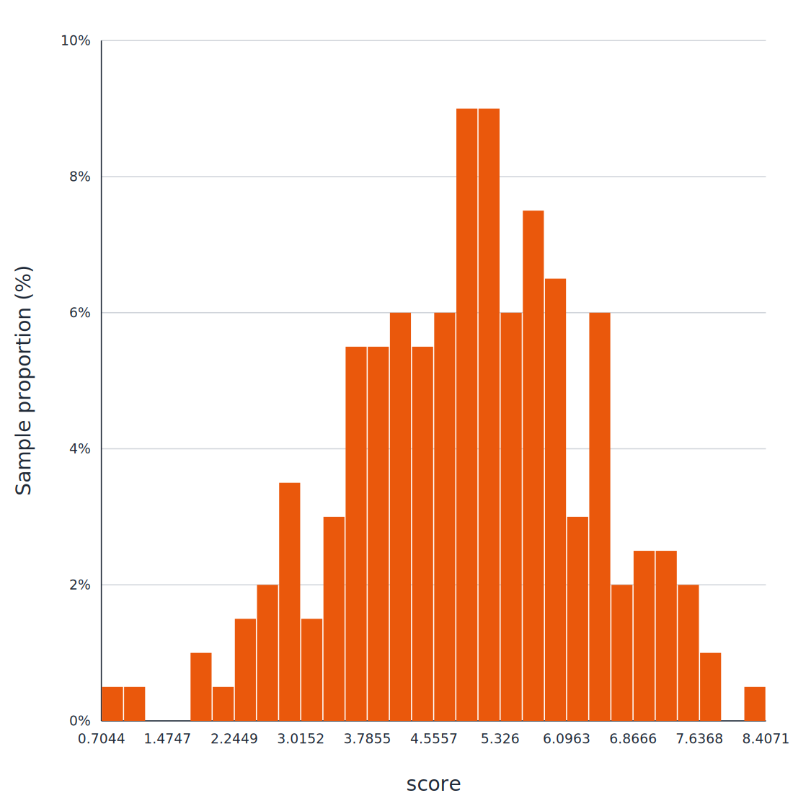

# Visualization

Plot DNA sequences, positions, alignments and similarity matrices into saveable images.

The plotting function returns a deterministic square `SVGArtifact`, and decorative titles such as "DNA sequence" are not displayed in the plot; data content such as coordinates, highlight labels, legends, and base numbers are still retained. The `title` in the configuration is only used for SVG accessibility instructions and will not be drawn within the image. All graphics are exported using `save_image()`; `image_type` can be selected from `png`, `svg` or `jpg`, and the default is `png`. If the target path does not have an extension, it will be automatically added. SVG does not require additional graphics dependencies, PNG/JPG needs to install `viz` extra; the original TIFF/PDF export continues to be compatible. Each example below will save the image to the current working directory. The "example result" shows the real image generated by the same code; the save function refuses to overwrite existing files by default.

## 1) `VIZ-001` Sequence text image

- **Function:** Draw DNA bases, coordinates and optional annotations into vector SVG, returning graphics that can be embedded in web pages or saved for quick viewing of short sequence content.
- **API**: `dnakit.visualization.plot_sequence(value[required], highlights[optional], config[optional])`; `config` uses `dnakit.visualization.SequencePlotConfig`.
- **Input**: `DNASequence` or `DNARecord`; optional number of bases per row, coordinates, complementary strand, row spacing, column spacing, custom character mapping and display upper limit.
- **Export**: `save_image(artifact, target, image_type[optional])`; optional `png`, `svg`, `jpg`, default `png`.
- **Sample Code**:

```python
from dnakit import DNASequence
from dnakit.visualization import SequencePlotConfig, plot_sequence, save_image

artifact = plot_sequence(
    DNASequence("ACGTGGTCCA"),
    config=SequencePlotConfig(bases_per_line=4),
)
save_image(artifact, "viz-001-sequence", image_type="png")
```

- **Example results (`viz-001-sequence.png`):**

{ width="420" }

## 2) `VIZ-002` position highlighting

- **Function**: Highlight bases or intervals by coordinates, color, and labels to make motifs, mutations, and other positions of interest clearly visible in sequence diagrams.
- **API**: `dnakit.visualization.Highlight(start[required], end[required], label[optional], color[optional], foreground[optional], priority[optional], opacity[optional])`, `dnakit.visualization.plot_sequence(value[required], highlights[optional], config[optional])`.
- **Input**: Sequence and highlight interval; optional label, color and priority.
- **Export**: `save_image(artifact, target, image_type[optional])`; optional `png`, `svg`, `jpg`, default `png`.
- **Sample Code**:

```python
from dnakit import DNASequence
from dnakit.visualization import Highlight, plot_sequence, save_image

artifact = plot_sequence(
    DNASequence("ACGTACGT"),
    highlights=[Highlight(1, 4, label="target", color="#ffcc00")],
)
save_image(artifact, "viz-002-highlight", image_type="png")
```

- **Example results (`viz-002-highlight.png`):**

{ width="420" }

## 3) `VIZ-003` style control

- **Function**: Control color, font, size, margin, line spacing, text column spacing and layout through unified style configuration, so that different visualization results have a consistent appearance and can be reproduced.
- **API**: `dnakit.visualization.SVGTheme(background[optional], foreground[optional], muted[optional], grid[optional], accent[optional], missing[optional], font_family[optional])`; use `SequencePlotConfig(font_size[optional], cell_width[optional], line_height[optional], column_spacing[optional], line_spacing[optional], margin[optional], theme[optional])` for sequence text images.
- **Input**: drawing configuration; `column_spacing` controls the horizontal pixels added between adjacent text columns, `line_spacing` controls the vertical pixels added between adjacent sequence lines, both default to `0`.
- **Export**: `save_image(artifact, target, image_type[optional])`; optional `png`, `svg`, `jpg`, default `png`.
- **Sample Code**:

```python
from dnakit import DNASequence
from dnakit.visualization import SVGTheme, SequencePlotConfig, plot_sequence, save_image

theme = SVGTheme(background="#111827", foreground="#f9fafb", accent="#22c55e")
artifact = plot_sequence(
    DNASequence("ACGTGGTCCA"),
    config=SequencePlotConfig(
        bases_per_line=4,
        font_size=18,
        column_spacing=8,
        line_spacing=18,
        theme=theme,
    ),
)
save_image(artifact, "viz-003-theme", image_type="png")
```

- **Example results (`viz-003-theme.png`):**

{ width="420" }

## 4) `VIZ-004` Gap display

- **Function**: Use special symbols to display the position and known or unknown length of the Gap in the sequence diagram, while maintaining the meaning of the coordinates to avoid mistakenly drawing the missing area as a real base.
- **API**: `dnakit.Gap(length[required], kind[optional], crossable[optional], evidence[optional], metadata[optional])`, `dnakit.visualization.plot_sequence(value[required], highlights[optional], config[optional])`.
- **Input**: `DNASequence` or record containing explicit `Gap` part.
- **Export**: `save_image(artifact, target, image_type[optional])`; optional `png`, `svg`, `jpg`, default `png`.
- **Sample Code**:

```python
from dnakit import DNASequence, Gap
from dnakit.visualization import plot_sequence, save_image

sequence = DNASequence(["AC", Gap(500), "T", Gap(None), "G"])
artifact = plot_sequence(sequence)
save_image(artifact, "viz-004-gap", image_type="png")
```

- **Example results (`viz-004-gap.png`):**

{ width="432" }

## 5) `VIZ-005` Linear sequence diagram

- **Function**: Draw the start and end range, direction and label of the feature along linear DNA coordinates to generate an SVG similar to a gene structure diagram, which can be used to view the relative positions of multiple annotations.
- **API**: `dnakit.visualization.plot_linear_map(value[required], width[optional], height[optional], max_features[optional], title[optional], theme[optional])`; the canvas side length takes the larger value between `width` and `height`, `title` is only used as an SVG accessibility description.
- **Input**: resolved linear `DNASequence` or `DNARecord` with `DNAFeature`; output is always square.
- **Export**: `save_image(artifact, target, image_type[optional])`; optional `png`, `svg`, `jpg`, default `png`.
- **Sample Code**:

```python
from dnakit import DNAFeature, DNARecord, DNASequence, Interval
from dnakit.visualization import plot_linear_map, save_image

record = DNARecord(
    DNASequence("ACGTACGT"),
    "linear",
    features=[DNAFeature("gene", Interval(1, 6))],
)
artifact = plot_linear_map(record)
save_image(artifact, "viz-005-linear-map", image_type="png")
```

- **Example results (`viz-005-linear-map.png`):**

{ width="900" }

## 6) `VIZ-006` Circular DNA diagram

- **Function**: Map circular DNA and its features to circular coordinates, display the direction, span-origin interval and label, which can be used for structural overview of plasmids or other circular molecules.
- **API**: `dnakit.visualization.plot_circular_map(value[required], size[optional], max_features[optional], title[optional], theme[optional])`; `size` is the side length of the square canvas, `title` is just an SVG accessibility specification.
- **Input**: The resolved sequence or record of `topology="circular"`.
- **Export**: `save_image(artifact, target, image_type[optional])`; optional `png`, `svg`, `jpg`, default `png`.
- **Sample Code**:

```python
from dnakit import DNAFeature, DNARecord, DNASequence, Interval
from dnakit.visualization import plot_circular_map, save_image

record = DNARecord(
    DNASequence("ACGTACGT", topology="circular"),
    "plasmid",
    features=[DNAFeature("gene", Interval(1, 6))],
)
artifact = plot_circular_map(record)
save_image(artifact, "viz-006-circular-map", image_type="png")
```

- **Example results (`viz-006-circular-map.png`):**

{ width="520" }

## 7) `VIZ-007` Custom character representation

- **Function**: Replace A, T, C, G or IUPAC symbols with the display characters specified by the caller, for example, A is displayed as `*`, T is displayed as `-`, C is displayed as `+`, and G is displayed as `]`; coordinates, highlighting, complementary relationships and base colors are still calculated according to the original sequence.
- **API**: `dnakit.visualization.SequencePlotConfig(symbol_map[optional])`; used via `plot_sequence(value, config=config)`.
- **Input**: The key for `symbol_map` is an uppercase DNA/IUPAC symbol and the value is a visible character; unconfigured symbols remain as is and the default mapping is empty.
- **Export**: `save_image(artifact, target, image_type[optional])`; optional `png`, `svg`, `jpg`, default `png`.
- **Sample Code**:

```python
from dnakit import DNASequence
from dnakit.visualization import SequencePlotConfig, plot_sequence, save_image

artifact = plot_sequence(
    DNASequence("ATCGATCG"),
    config=SequencePlotConfig(
        bases_per_line=4,
        font_size=20,
        column_spacing=8,
        line_spacing=14,
        symbol_map={"A": "*", "T": "-", "C": "+", "G": "]"},
    ),
)
save_image(artifact, "viz-007-custom-symbols", image_type="png")
```

- **Example results (`viz-007-custom-symbols.png`):**

{ width="420" }

## 8) `VIZ-008` Alignment diagram

- **Function**: Draw two paired sequences in columns, distinguish matches, mismatches, insertions and deletions, and display coordinates to facilitate manual inspection of difference positions.
- **API**: `dnakit.visualization.plot_alignment(result[required], columns_per_line[optional], max_columns[optional], theme[optional])`.
- **Input**: precomputed `AlignmentResult`; optional number of rows and upper bounds, output always square.
- **Export**: `save_image(artifact, target, image_type[optional])`; optional `png`, `svg`, `jpg`, default `png`.
- **Sample Code**:

```python
from dnakit import DNASequence
from dnakit.alignment import align_pairwise
from dnakit.visualization import plot_alignment, save_image

alignment = align_pairwise(DNASequence("ACGT"), DNASequence("AGT"))
artifact = plot_alignment(alignment, columns_per_line=4)
save_image(artifact, "viz-008-alignment", image_type="png")
```

- **Example results (`viz-008-alignment.png`):**

{ width="640" }

## 9) `VIZ-009` Classification and regression sample distributions {#viz-009}

Read named CSV columns and create one proportion plot per column. **Bar height is the category/bin count divided by that column's valid sample count**, displayed as a percentage. The heights sum to 100% before display rounding. These plots describe the sample distribution, not a model's confidence for an individual sample.

- `classification`: one bar per observed category, in first-seen order by default. Explicit `categories` set the order and can include absent labels with zero counts; all observed labels must be included.
- `regression`: a histogram with 30 equal-width bins by default. Set `bins` or provide strictly increasing `bin_edges` covering every valid sample. Bins include their left edge; only the final bin includes its right edge. Constant columns use one 100% bin. Unequal-width bins still show proportions, not density.
- Blank/whitespace cells and Python `None` are skipped and reported. Empty columns, invalid numeric values, NaN/infinity in regression, duplicate headers, missing columns, and malformed rows raise errors. Classification labels are trimmed strings; `0` and `0.0` remain separate categories.
- Multiple columns are normalized independently using the same task and style. Call separately for mixed classification/regression data. The default limit is 1,000,000 rows including blank cells, and at most 1,000 categories/bins; exceeding limits raises rather than truncating data.

The repository includes a [200-row synthetic CSV](../../assets/data/distribution.csv) at `docs/assets/data/distribution.csv`, with `label`, `score`, and `score_alt` columns. Labels 0, 1, and 2 have 40, 100, and 60 samples respectively. Run examples from the repository root after installing DNAKit. PNG/JPG/PDF export requires `python -m pip install -e ".[viz]"`; SVG needs only the base installation.

To plot category proportions with percentage labels and a custom font size:

```bash
python -m dnakit.cli plot-distribution \
  --input docs/assets/data/distribution.csv \
  --column label \
  --task classification \
  --output outputs/label_distribution.png \
  --category 0 \
  --category 1 \
  --category 2 \
  --show-values \
  --font-family sans-serif \
  --font-size 18 \
  --color '#2563eb' \
  --dpi 150
```

{ width="480" }

To plot a continuous column as a histogram of sample proportions:

```bash
python -m dnakit.cli plot-distribution \
  --input docs/assets/data/distribution.csv \
  --column score \
  --task regression \
  --output outputs/score_distribution.png \
  --bins 30 \
  --bar-width 0.95 \
  --font-size 18 \
  --color '#ea580c' \
  --dpi 150
```

{ width="480" }

Repeat `--column` and `--output` for multiple columns, with one filename per column in matching order. Use `--bin-edges '0,2,4,6,8,10'` for explicit edges instead of automatic bins; for negative starting edges use `--bin-edges=-10,-5,0,5,10,15`. Automatic ranges are independent per column; supply common edges to compare matching intervals.

The Python API returns a dictionary of SVG artifacts for subsequent export:

```python
from dnakit.visualization import (
    DistributionPlotConfig,
    ImageExportConfig,
    SVGTheme,
    plot_csv_distributions,
    save_image,
)

plots = plot_csv_distributions(
    "docs/assets/data/distribution.csv",
    columns=["score", "score_alt"],
    task="regression",
    config=DistributionPlotConfig(
        bins=25,
        size=800,
        font_size=20,
        tick_font_size=14,
        theme=SVGTheme(font_family="sans-serif", accent="#ea580c"),
    ),
)
for column, artifact in plots.items():
    print(column, artifact.metadata["counts"], artifact.metadata["proportions"])
    save_image(
        artifact,
        f"outputs/{column}.png",
        config=ImageExportConfig(dpi=150, create_parents=True),
    )
```

For an existing list, use `plot_distribution(values, task=..., config=...)`. Metadata includes `total_count`, `valid_count`, `missing_count`, `labels`, `counts`, `proportions`, and `bin_edges`.

| Configuration / CLI | Default | Meaning |
| --- | --- | --- |
| `bins` / `--bins` | `30` | Number of automatic numeric bins |
| `bin_edges` / `--bin-edges` | `None` | Explicit boundaries, overriding `bins` |
| `categories` / repeated `--category` | `None` | Explicit category order including optional absent labels |
| `size` / `--size` | `720` | Square SVG canvas side, at least 320 |
| `font_size` / `--font-size` | `16` | Axis label font size |
| `tick_font_size` / `--tick-font-size` | `12` | Tick label font size |
| `value_font_size` / `--value-font-size` | `11` | Bar percentage font size |
| `theme.font_family` / `--font-family` | API `monospace`; CLI `sans-serif` | Installed font family |
| `theme.accent` / `--color` | `#2563eb` | Bar color |
| `theme.background` / `--background` | `#ffffff` | Background color; API themes also configure grid/text colors |
| `bar_width` / `--bar-width` | `0.9` | Fraction of the category slot/bin width; 1 removes gaps |
| `label_rotation` / `--label-rotation` | `0` | X tick rotation: 0, 45, or 90 degrees |
| `max_tick_labels` / `--max-tick-labels` | `12` | X tick density; histograms also retain the rightmost edge |
| `show_values` / `--show-values` | `False` | Show bar percentages; leave off for dense histograms |
| `show_grid` / `--grid`, `--no-grid` | `True` | Horizontal grid lines |
| `x_label` / `--x-label` | CSV column name | X axis label |
| `y_label` / `--y-label` | `Sample proportion (%)` | Y axis label; normalization remains sample proportion |
| Export `dpi` / `--dpi` | `600` | Default raster side is approximately `size × dpi / 96` pixels |
| `encoding` / `--encoding` | `utf-8-sig` | CSV encoding, accepting UTF-8 BOM |
| `delimiter` / `--delimiter` | `,` | Single-character delimiter |
| `max_values` / `--max-values` | `1000000` | Input row limit, including blank cells |

Export supports PNG, SVG, JPG, TIFF, and PDF. Extensionless filenames receive `.png`. The CLI creates parent directories and refuses to overwrite existing files unless `--overwrite` is supplied. As with existing plots, `title` is SVG accessibility text rather than an in-plot heading.
