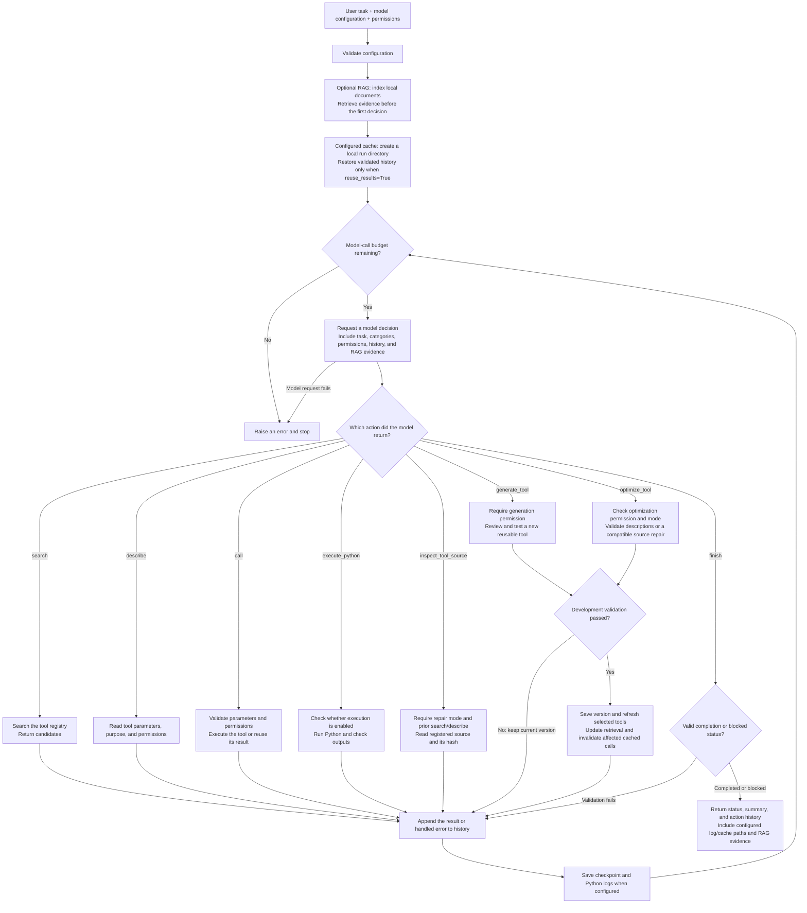

# Agent

DNAKit's built-in Agent accepts a natural-language task and uses a configured LLM to discover tools, inspect their parameters, execute them, and summarize the results. Call `dnakit.tools.run_agent()` directly from Python; no MCP server or `dnakit[agent]` extra is required.

The model selects one of eight actions per round, then uses the observation to decide what to do next. Tool generation and optimization require explicit caller permission; optimization can edit descriptions or perform compatible local source repairs. Optional result caching restores validated work, and RAG retrieves evidence from a caller-selected knowledge directory before the first decision. Caching and RAG are runtime settings, not model actions.



<span id="agent-tool-calling"></span>

## 1) Quick start

Install DNAKit core:

```bash
python -m pip install dnakit
```

Set the model name and credentials in your terminal or IDE run configuration. This example uses DeepSeek; the model must support JSON mode. See [Python API](python_api.md#custom-llm) for other providers and request options.

```bash
export DNAKIT_LLM_MODEL="your-available-model-name"
export DEEPSEEK_API_KEY="your-api-key"
```

### run_agent: Run a task automatically

- **Purpose:** Accept a natural-language task, select and call DNAKit tools, and return a result summary and execution history.
- **Method:** Send the task, permissions, tool categories, and history to the model each round, execute one JSON action, then use the observation to decide the next action until the task finishes or reaches the step limit.
- **API:** `dnakit.tools.run_agent(request[required], config[required], allow_side_effects[optional], max_steps[optional], registry[optional], search_mode[optional], search_limit[optional], code_execution[optional], cache_dir[optional], reuse_results[optional], rag[optional], generate_tools[optional], optimize_tools[optional], optimization_mode[optional], verbose[optional])`. All arguments after `request` are keyword-only.
- **Input:** A task string and `LLMConfig` are required. Defaults allow up to 50 model calls and retrieve 5 candidates per search. `generate_tools=False`, `optimize_tools=False`, and `optimization_mode="description_only"`; Python execution, persistent caching and RAG are also disabled unless configured. `verbose=True` shows execution progress. Development reviews and evaluations share the model-call budget.
- **Example code:** Configure the model and credentials above, then run:

```python
import os

from dnakit.llm import LLMConfig
from dnakit.tools import run_agent

config = LLMConfig(provider="deepseek", model=os.environ["DNAKIT_LLM_MODEL"])
request = "Calculate the molecular weight of ACGT and the reverse complement of AACG."
result = run_agent(request, config=config, max_steps=50)
print(result.status)
print(result.text)
```

- **Example result:** The final two lines below illustrate a successful run, omitting the default progress output. Model wording and action counts can vary.

```text
completed
The molecular weight of ACGT is 1173.84 Da; the reverse complement of AACG is CGTT.
```

For ordinary tool use, the Agent repeats `search → describe → call`, observes the results, then continues or returns `finish`. Caller-enabled Python execution, generation and optimization add the branches shown above. Its default progress output reports each action and tool name.

For tasks that write files, download data, or invoke tools requiring authorization, specify the destination and enable `allow_side_effects` explicitly:

```python
result = run_agent(
    "Download the human hg38 reference genome FASTA to data/hg38 without overwriting existing files.",
    config=config,
    allow_side_effects=True,
)
print(result.text)
```

<span id="agent-actions"></span>

## 2) Functions and actions

The flowchart covers eight model actions and two optional runtime capabilities. `search`, `describe`, and `call` have corresponding registry methods for manual use; the other actions are handled by `run_agent()`. The `[required]` and `[optional]` markers below explain parameters and are not Python call syntax. Python examples reuse `config` from quick start.

| Item | Role | Enabling condition and outcome |
| --- | --- | --- |
| [1. `search`](#agent-search) | Action: find candidate tools | Available by default; returns candidate names and summaries |
| [2. `describe`](#agent-describe) | Action: inspect a tool's interface | Requires prior discovery; returns descriptions, schemas and permissions |
| [3. `call`](#agent-call) | Action: execute a registered tool | Requires prior description and applicable permissions; returns a serialized result |
| [4. `execute_python`](#agent-execute-python) | Action: run supplementary code | Requires `code_execution` and `allow_side_effects=True`; returns process status and output checks |
| [5. `generate_tool`](#agent-generate-tool) | Action: create a missing reusable function | Requires `generate_tools=True`, side-effect permission and a writable source checkout; validated candidates become callable tools |
| [6. `inspect_tool_source`](#agent-inspect-tool-source) | Action: read source before repair | Requires `optimize_tools=True`, repair mode, prior search and description; returns source and `base_sha256` |
| [7. `optimize_tool`](#agent-optimize-tool) | Action: improve descriptions or repair implementation | Requires `optimize_tools=True`, side-effect permission and a writable source checkout; behavior depends on the configured mode |
| [8. `finish`](#agent-finish) | Action: finish or report a blocker | Validates status and completion evidence, then returns `AgentResult` |
| [9. Result cache](#agent-result-cache) | Runtime capability: save and restore work | Configure `cache_dir` and optionally `reuse_results=True`; exposes `cache_dir` and `reused_steps` |
| [10. Knowledge retrieval](#agent-knowledge-retrieval) | Runtime capability: retrieve local reference material | Configure `rag=RAGConfig(...)`; exposes retrieved passages in `knowledge_context` |

The model cannot enable these permissions or invent `cache`/`rag` JSON actions. Configuration remains under caller control.

<span id="agent-search"></span>

### 1) Search: Find tools

- **Purpose:** Find candidates relevant to a task in the registered tool catalog, including their names, descriptions, and categories.
- **Method:** Default keyword retrieval matches tool names, descriptions, and categories. Semantic retrieval uses embeddings and cosine similarity; hybrid retrieval combines both rankings. This action does not execute candidate tools or search the internet.
- **API:** `AgentToolRegistry.search(query[optional], category[optional], limit[optional], include_python_only[optional], mode[optional])`; model action format: `{"action":"search","query":"capability keywords"}`.
- **Input:** For manual calls, `query` defaults to an empty string to list tools; Agent actions require a nonempty `query`. Direct calls default to `limit=20`; the Agent uses the caller's `search_limit`, defaulting to `5`. `mode` accepts `keyword`, `semantic`, or `hybrid`; the latter two require an embedding service.
- **Example code:** This keyword search runs offline without model credentials.

```python
from dnakit.tools import default_tool_registry

registry = default_tool_registry(verbose=False)
tools = registry.search("dnakit.thermodynamics.molecular_weight", limit=1)
print([tool.name for tool in tools])
```

- **Example result:**

```text
['dnakit.thermodynamics.molecular_weight']
```

<span id="agent-describe"></span>

### 2) Describe: Inspect tool parameters

- **Purpose:** Read a selected tool's parameter schema, required fields, purpose, and permissions to prepare valid arguments.
- **Method:** The registry resolves the tool name and returns its full manifest. The Agent only describes tools discovered by search in the current task, and records that their descriptions have been read. Manual registry calls do not require a prior search.
- **API:** `AgentToolRegistry.describe(name[required])`; model action format: `{"action":"describe","tool_name":"full tool name"}`.
- **Input:** A tool name, preferably the full name returned by `search`. The result's `input_schema` describes parameters, `effect` identifies the operation type, and `requires_confirmation` indicates whether side effects require caller authorization.
- **Example code:**

```python
from dnakit.tools import default_tool_registry

registry = default_tool_registry(verbose=False)
info = registry.describe("dnakit.thermodynamics.molecular_weight")
print(info["name"])
print(info["input_schema"]["required"])
print(info["effect"])
print(info["requires_confirmation"])
```

- **Example result:**

```text
dnakit.thermodynamics.molecular_weight
['sequence']
local
False
```

<span id="agent-call"></span>

### 3) Call: Execute a tool

- **Purpose:** Call a DNAKit tool with explicit arguments and return a result for the model or subsequent steps.
- **Method:** The Agent checks that the tool was searched for and described, resolves `$ref` references in the arguments, then uses the registry to check permissions, convert arguments, and call the function. Identical tools and arguments reuse previous observations within a task, including failures. Direct `registry.execute()` calls do not maintain these Agent history or deduplication rules and do not resolve `$ref` references.
- **API:** `AgentToolRegistry.execute(name[required], arguments[optional], allow_side_effects[optional])`; model action format: `{"action":"call","tool_name":"full tool name","arguments":{}}`. The public method is `execute()`; there is no `registry.call()` method.
- **Input:** A tool name and an argument dictionary matching its schema. Manual calls use an empty dictionary when `arguments` is omitted; Agent actions require this field. Tools requiring authorization for file writes, model operations, or external processes need `allow_side_effects=True`; the model cannot grant itself permission.
- **Example code:** This calls the molecular-weight tool directly without an LLM request.

```python
from dnakit.tools import default_tool_registry

registry = default_tool_registry(verbose=False)
result = registry.execute(
    "dnakit.thermodynamics.molecular_weight",
    {"sequence": "ACGT"},
)
print(round(result["value_dalton"], 2))
```

- **Example result:**

```text
1173.84
```

<span id="agent-execute-python"></span>

### 4) Execute Python: Run supplementary code

- **Purpose:** Let the Agent write and execute supplementary Python when an existing tool lacks a processing step or tools cannot directly exchange data, then continue using the result.
- **Method:** Once enabled by the caller, the runner resolves result references in `inputs`, saves the inputs as JSON, and starts a fresh Python subprocess with the input file path in `sys.argv[1]`. It checks the exit code, timeout, and declared outputs, then returns output or errors for the model to act on. Identical code, inputs, and output lists reuse the previous observation.
- **API:** `execute_python` is an internal `run_agent()` action, with no public function of the same name. Configure it through `PythonExecutionConfig(workspace[required], timeout_seconds[optional], max_attempts[optional], max_output_bytes[optional])` and enable it with `run_agent(..., allow_side_effects=True, code_execution=configuration)`.
- **Input:** Actions must include `reason`, `code`, `inputs`, and `expected_outputs`; use `expected_outputs=[]` when no output files are needed. Defaults are 120 seconds per execution, 5 attempts, and the final 16,000 bytes of each stdout/stderr stream returned to the model. See [Python fallback and failure recovery](#python-execution) for configuration and logs.
- **Example code:** This is an action the model may return when Python execution is enabled. The JSON itself is not a directly callable Python function.

```json
{
  "action": "execute_python",
  "reason": "Check the length of the input sequence",
  "code": "import json, sys\nwith open(sys.argv[1], encoding='utf-8') as stream:\n    data = json.load(stream)\nassert isinstance(data['sequence'], str)\nprint(len(data['sequence']))",
  "inputs": {"sequence": "ACGT"},
  "expected_outputs": []
}
```

- **Example result:** An excerpt of the observation after successful execution; directory, duration, and other fields are omitted.

```json
{
  "ok": true,
  "result": {
    "status": "succeeded",
    "returncode": 0,
    "stdout": "4\n",
    "outputs": []
  }
}
```

<span id="agent-generate-tool"></span>

### 5) Generate Tool: Add a reusable capability

- **Purpose:** Create a reusable DNAKit function when searching and composing existing capabilities leaves a real gap.
- **Configuration:** Enable `generate_tools=True` and `allow_side_effects=True` in a writable DNAKit source checkout. The flag defaults to `False`; it permits generation without requiring the model to generate a tool for every task.
- **Method:** The `generate_tool` action supplies a contract, source and fixed tests. Code quality checks, an independent model review and real subprocess execution must pass before activation. Missing credentials or dependencies do not justify generation; dependencies are not installed automatically.
- **Example code:** Use a request that explains the required capability and expected result. With `request` and `config` already defined:

```python
result = run_agent(
    request,
    config=config,
    allow_side_effects=True,
    generate_tools=True,
)
print(result.text)
```

- **Expected outcome:** An activated development step in `result.steps` has `observation.result.status="activated"`, `tool_name`, `change_id`, `artifacts` and `audit_dir`. The source and manifest under `src/dnakit/generated/` expose `dnakit.generated.<name>` to Python and the existing MCP call endpoint. Tests, bilingual usage and contribution metadata are also prepared. Rejected candidates remain diagnostic observations; the Agent must describe an activated tool and verify the original task with it.

See [development validation, artifacts and rollback](#agent-development) for the full workflow.

<span id="agent-inspect-tool-source"></span>

### 6) Inspect Tool Source: Read the implementation before repair

- **Purpose:** Give the model the actual registered function definition and its source identity before proposing a code change.
- **Configuration:** Requires `optimize_tools=True`, `optimization_mode="repair"`, `allow_side_effects=True` and a writable source checkout. Search and describe this same tool first. Source inspection itself does not repair or execute the function.
- **Input:** The full registered tool name. The source must be an inspectable top-level Python function in the checkout; this includes generated tools and selected custom public exports. Unsupported or ambiguous source locations are rejected.
- **Example action:** After discovering and describing this tool, the model can return:

```json
{
  "action": "inspect_tool_source",
  "tool_name": "dnakit.thermodynamics.molecular_weight"
}
```

- **Expected outcome:** `observation.result` contains `source`, `source_path`, `relative_path`, `function_name`, `kind` and `base_sha256`, plus schemas and effect metadata. `base_sha256` fingerprints the original module bytes, not just the displayed function excerpt. A repair must use the observed name, kind and hash; source changes require a fresh inspection. Restored source evidence is also checked against current files.

Inspection is an internal action selected by `run_agent()`, not a separate method on `AgentToolRegistry`. See [compatible source repair](#agent-development).

<span id="agent-optimize-tool"></span>

### 7) Optimize Tool: Improve descriptions or repair code

- **Purpose:** Improve tool use when the evidence shows ambiguous documentation, or repair a reproducible implementation problem while preserving existing calls.
- **Configuration:** `optimize_tools=True` independently enables this action and requires side-effect permission plus a writable source checkout. `optimization_mode="description_only"` is the default. Explicitly select `"repair"` to permit local implementation changes; generation does not have to be enabled.
- **Method:** Description optimization compares planning and real execution under the old and proposed descriptions. Repair requires prior source inspection, fixed baseline/candidate tests, code checks and model review. Accepted repairs retain existing successes and demonstrate a fix or new optional behavior. Existing names, parameter names/order/kinds/types/defaults and return interfaces remain intact; new parameters must be keyword-only with defaults.
- **Example code:** Supply the observed problem and expected behavior in `request`. This enables repair; use `optimization_mode="description_only"` for text changes alone:

```python
result = run_agent(
    request,
    config=config,
    allow_side_effects=True,
    optimize_tools=True,
    optimization_mode="repair",
)
print(result.text)
```

- **Expected outcome:** An activated `optimize_tool` step exposes `status`, `change_id`, `artifacts`, `audit_dir` and validation evidence in `observation.result`. Native/MCP description overlays use `src/dnakit/tools/_data/descriptions.json`; skill edits update their Markdown and catalog metadata. Repairs update the selected source, refresh its function/schema in the current Agent and prepare contribution files. The Agent then describes and calls the updated tool to verify the task. A failed validation leaves a rejected observation instead of claiming a successful change.

Repair mode applies to native and previously generated DNAKit functions in the checkout, including a custom public export present in the caller's registry. The action can still explicitly select `mode="description_only"`. Third-party MCP implementations and skill code are not repaired through this action: MCP and skill targets retain description-only optimization. See [the detailed development workflow](#agent-development) for scope, test evidence and version recovery.

<span id="agent-finish"></span>

### 8) Finish: End a task

- **Purpose:** End the current Agent loop with a completion status and result summary, or explain a blocking issue.
- **Method:** Validate `status` and a nonempty `text`. Declaring `completed` requires the most recent tool/code execution to have succeeded, or retrieved RAG evidence supporting a direct answer. A failed call cannot be overridden by earlier retrieval evidence. `blocked` does not require a successful call. A valid finish returns `AgentResult` and saves the status when Python execution or checkpointing is enabled.
- **API:** `finish` is an internal `run_agent()` action, with no separate public `finish()` function. Callers read `status`, `text`, `steps`, and `execution_dir` from the returned object.
- **Input:** Required `status` (`completed` or `blocked`) and `text` (a nonempty summary). Exceeding the step limit or encountering a model request error raises an exception instead of automatically returning `blocked`.
- **Example code:** Assuming the molecular weight of ACGT has already been calculated successfully, the model returns:

```json
{
  "action": "finish",
  "status": "completed",
  "text": "The molecular weight of ACGT is 1173.84 Da."
}
```

The caller reads the `run_agent()` return value:

```python
print(result.status)
print(result.text)
```

- **Example result:** For the action above; a successful `finish` action is not itself appended to `result.steps`.

```text
completed
The molecular weight of ACGT is 1173.84 Da.
```

<span id="agent-result-cache"></span>

### 9) Result Cache: Restore completed work

- **Purpose:** Preserve completed calls and their history across invocations so an interrupted task can continue from validated results.
- **Configuration:** Set `cache_dir` to save local JSON checkpoints and `reuse_results=True` to restore them. Defaults are `cache_dir=None` and `reuse_results=False`. These runner settings need no database or source checkout; caching itself does not require `allow_side_effects=True`.
- **Example code:** Reuse exactly the same request and directories when resuming. A first invocation with no saved checkpoint starts normally:

```python
result = run_agent(
    request,
    config=config,
    cache_dir="./agent_cache",
    reuse_results=True,
)
print(result.cache_dir, result.reused_steps)
```

- **Expected outcome:** `result.cache_dir` identifies this invocation's folder containing `checkpoint.json`; `reused_steps` counts restored successful `call` and `execute_python` steps. Valid history preserves its step numbers and `$ref` references. Tool definitions, permissions and identifiable files are checked; the first invalid step and all later steps are discarded. Unknown interrupted outcomes are not treated as success or blindly rerun.

The example only configures caching; separately enable any file/model/process effects required by the task. See [cache validation and recovery](#agent-cache) for failure handling and limits.

<span id="agent-knowledge-retrieval"></span>

### 10) Knowledge Retrieval: Use a selected local knowledge base

- **Purpose:** Retrieve evidence from your own documents to inform the model's answer or analysis.
- **Configuration:** Pass `rag=RAGConfig(directory=...)`; RAG is disabled when `rag=None`. It works with an ordinary installation and does not itself require side-effect permission. Retrieval runs once with the original request before the first decision in each invocation. The resulting passages accompany subsequent decisions; the model does not emit a RAG action.
- **Example code:** Prepare supported UTF-8 text documents in `./knowledge` first. Keyword retrieval uses a local JSON index and no embedding service:

```python
from dnakit.tools import RAGConfig, run_agent

result = run_agent(
    "Explain our lab's FASTQ acceptance criteria and cite the sources.",
    config=config,
    rag=RAGConfig(directory="./knowledge", index_dir="./knowledge_index"),
)
for hit in result.knowledge_context:
    print(hit["source"], hit["chunk_id"], hit["text"])
```

- **Expected outcome:** The index is saved under `index_dir`; `result.knowledge_context` contains passages with `source`, `path`, `chunk_id`, `offset`, `text` and `score`. Relevant evidence can support a direct document answer; analysis and file-creation tasks still require execution. Retrieved excerpts are sent to the configured chat model. Optional semantic/hybrid retrieval additionally requires a separate embedding configuration.

This retrieves user-provided reference material; it does not automatically accumulate memories or preferences. See [supported formats, index limits and retrieval modes](#agent-rag).

<span id="agent-files"></span>

## 3) Resolve missing URLs and pass files between tools

A task may specify only a dataset name, subset and output directory. `run_agent()` already
uses `call_llm()` at every step. To obtain missing external information, the model can discover:

| Tool | Purpose |
| --- | --- |
| `dnakit.search.web_search` | Search the internet for candidate pages, returning titles and URLs |
| `dnakit.search.read_webpage` | Read an HTTPS page or text/JSON API, returning text and observed links |
| `dnakit.download.download_url` | Save a confirmed file URL to a local directory |

The Agent's `search` action still searches the installed tool catalog. Web search uses Tavily
when `TAVILY_API_KEY` is set, otherwise keyless DuckDuckGo HTML; `provider` can select explicitly.
No additional Python dependency is needed. The search key stays in the process environment.
A DuckDuckGo challenge is reported as an error, never as an empty successful search. Configure
Tavily or read a known candidate page to verify it. Web content is untrusted data, not Agent
instructions. No page scripts run and no unobserved download links are invented by the reader.

```python
from dnakit.search import read_webpage, web_search

candidates = web_search("NT revised H2AFZ dataset")
page = read_webpage(candidates.records[0]["url"], match="H2AFZ")
print(page.to_dict())
```

The reader defaults to 8,000 text characters and 30 links. `match` filters by substring;
`offset` and `link_offset` paginate, with explicit truncation flags and continuation offsets.
Binary resources belong in the downloader. `call_llm(file_path=...)` remains a text-file input.

The existing ML trainer accepts `CustomPropertyTrainingConfig(cv_folds=10, ...)`. It validates
all folds of a training-only source, saves validation-fold membership, out-of-fold predictions
and metrics, then refits the final model on all source rows. This is supported only with
`finetune_method="machine_learning"`; split ratios are ignored and mapped split columns are
rejected. An independent test file is used only for subsequent prediction. Each fold fits its
own preprocessing and model using training rows alone.
`predict_custom_properties(..., output_path="predictions.csv")` saves predicted labels locally.
Its `to_dict()`/Agent result then contains a file summary; Python prediction/probability attributes
remain available. Feed the CSV to `plot_csv_distributions` and save the plot with `save_image`.

Agent `call` arguments can reference earlier successful results, for example
`{"artifact": {"$ref": {"step": 12, "path": ["label"]}}}`. Step numbers start at 1;
the path selects result keys/list indices, with an empty path selecting the whole result.
References resolve locally, so the model need not regenerate SVG or copy large payloads.
Direct `registry.execute()` calls do not interpret these Agent references.

Automatic field detection checks candidate ID uniqueness for built-in readers. Duplicate names
use stable source-row IDs without dropping samples, with an inspection warning. Explicitly
mapped `DataMapping.id_field` values still require unique IDs.

<span id="python-execution"></span>

## 4) Python fallback and failure recovery

When tools cannot directly exchange data or a processing step is missing, the same
Agent can write and execute Python, then resume registered tool calls. Enable it explicitly:

```python
from dnakit.tools import PythonExecutionConfig, run_agent

result = run_agent(
    request,
    config=config,
    allow_side_effects=True,
    code_execution=PythonExecutionConfig(
        workspace="agent-output",
        timeout_seconds=600,
        max_attempts=5,
    ),
)
print(result.text)
print(result.execution_dir)
```

The model prefers existing tools. After finding a capability gap or receiving an error,
it can choose the `execute_python` runtime action with `reason`, complete `code`,
`inputs`, and `expected_outputs`. Input `$ref` values resolve locally into a JSON
file passed as `sys.argv[1]`; the model need not copy sequences, predictions or SVG
into source code. Subsequent tool calls can reference execution output paths.

Scripts run in fresh subprocesses with the current Python interpreter. Nonzero exit,
timeout, or missing/empty declared output files produce failed observations that the
model can use to correct its code. Identical code, inputs and output lists reuse the
previous observation. Inspection scripts count toward `max_attempts`; all actions
also count toward `max_steps`. Defaults are 120 seconds per execution and 5 attempts.
Each stdout/stderr tail sent to the model is limited to 16,000 bytes; full logs stay
on disk. POSIX cleanup terminates the process group on timeout, interruption or script
exit. On Windows, only the directly launched Python process is terminated.

Audit files live under `<workspace>/.dnakit_agent/run_*/`: `history.jsonl` records
actions and observations, and `summary.json` records status and actual execution count.
Each `attempt_*/` contains `script.py`, `inputs.json`, `request.json` (reason and output
paths), `stdout.log`, `stderr.log`, and `result.json` (exit code, time, file checks).
Automatic code attempts are distinct from human interventions.

This is **not a sandbox**: scripts have the current user's filesystem, network and
environment access. The workspace is a cwd, not an access boundary. Execution is
disabled by default and also requires caller-owned `allow_side_effects=True`.
File existence is not scientific validation: scripts should assert task-specific
row counts, columns and sequence lengths. Missing credentials, dependencies or
external resources can still block completion.

<span id="tool-search-modes"></span>

## 5) Configure tool retrieval

Default keyword retrieval needs no embedding service. For semantic or hybrid retrieval, first set the separate embedding environment variables described in [Python API: tool search modes](python_api.md#tool-search-modes), then create a registry:

```python
from dnakit.tools import AgentToolRegistry, EmbeddingConfig

registry = AgentToolRegistry(embedding_config=EmbeddingConfig(
    model=os.environ["DNAKIT_EMBEDDING_MODEL"],
    base_url=os.environ["DNAKIT_EMBEDDING_BASE_URL"],
))
```

Pass this registry to `run_agent()` using the chat `config` from quick start. The chat model chooses tools and arguments; the embedding model produces retrieval vectors:

```python
from dnakit.tools import run_agent

result = run_agent(
    "Calculate the molecular weight of ACGT.",
    config=config,
    registry=registry,
    search_mode="hybrid",
    search_limit=10,
)
print(result.text)
```

`run_agent()` defaults to `search_mode="keyword"` and `search_limit=5`; candidate limits accept 1–100. The model cannot change the caller's mode or limit. `max_steps=50` bounds total model calls, including development reviews and evaluations but excluding independent embedding API requests. This example executes the selected molecular-weight tool.

<span id="agent-cache"></span>

## 6) Local result caching and resuming work

Configure checkpoints on `run_agent()`; no database is needed:

```python
result = run_agent(
    "Analyze samples.fasta and write the report under results/.",
    config=config,
    allow_side_effects=True,
    cache_dir="./agent_cache",
    reuse_results=True,
)
print(result.reused_steps, result.cache_dir)
```

`cache_dir=None` disables cross-run persistence. With a directory, each action is saved atomically to a local `checkpoint.json`. `reuse_results=False` starts fresh and preserves previous run folders. `True` restores the latest valid history for the same request text, current working directory, Python workspace and retrieved RAG evidence; a missing checkpoint starts normally. Changed retrieved content isolates the task from history based on older evidence.

Checkpoints use this directory layout:

```text
<cache_dir>/agent_runs/<identity>/run_<time>_<random>/checkpoint.json
```

`AgentResult.cache_dir` points to the invocation's `run_*` directory. The JSON stores action history and validation evidence; large result files stay at their original paths. Caching works in ordinary package installations without a database or development permissions. Any scientific tool effects still require their own caller authorization.

Successful steps retain their original numbers and `$ref` references. If steps 1–3 succeeded before step 4 failed or the next model request was interrupted, the next invocation starts with the recovered history. Failures remain diagnostic context but are excluded from the restored result-reuse map, allowing corrected retries. `max_steps` counts NEW model decisions in this invocation. The final answer is not replayed automatically; the model examines history and continues or summarizes.

Restoration checks current permissions, tool definitions, identifiable file inputs and output artifacts. An invalid step and every later history step are discarded, retaining only the valid prefix. Large output files remain at their original paths rather than being copied into the checkpoint. Python restoration requires execution to remain enabled and checks declared inputs, outputs and audit files. Hidden Python dependencies, remote state and arbitrary environment changes cannot be fully validated; use `reuse_results=False` when a fresh run is needed.

A pending action is recorded before execution. If execution is interrupted before its result is saved, its outcome is marked uncertain. It is not considered successful, and an identical call is not automatically replayed. Inspect actual outputs first; explicitly start fresh when rerunning is appropriate. This does not guarantee exactly-once external operations or replace `allow_side_effects`.

<span id="agent-rag"></span>

## 7) Retrieve from a local knowledge directory before answering

Place UTF-8 documents in your own directory and pass `RAGConfig`. DNAKit reads, chunks and indexes them, then retrieves evidence once using the original request before the first model decision in each invocation. Later decisions receive the same `knowledge_context`:

```python
from dnakit.tools import RAGConfig, run_agent

result = run_agent(
    "Explain our lab's FASTQ quality acceptance criteria and cite the sources.",
    config=config,
    cache_dir="./agent_cache",
    reuse_results=True,
    rag=RAGConfig(
        directory="./knowledge",
        index_dir="./knowledge_index",
        mode="keyword",
        top_k=5,
    ),
)
print(result.text)
for hit in result.knowledge_context:
    print(hit["source"], hit["chunk_id"], hit["text"])
```

Keyword retrieval is local and makes no embedding requests. Supported UTF-8 plain-text formats, including files with a UTF-8 BOM, are TXT, Markdown (`.md`/`.markdown`), RST, JSON/JSONL, CSV/TSV and YAML (`.yaml`/`.yml`). Convert PDF, Office documents and scans to text first. Indexes are JSON files, not databases, and source-content changes update the index. File counts, file sizes, total bytes, chunk counts and returned context are bounded; progress is enabled by default.

| `RAGConfig` parameter | Default and purpose |
| --- | --- |
| `directory` | Required; the caller-selected local document directory |
| `index_dir` | `None`; choose a dedicated index directory or use the cache location below |
| `mode` | `"keyword"`; also accepts `"semantic"` and `"hybrid"` |
| `embedding_config` | `None`; a separate `EmbeddingConfig` is required for semantic/hybrid retrieval |
| `top_k` | `5`; maximum number of returned passages |
| `chunk_size` / `chunk_overlap` | `1200` / `150` characters |
| `max_context_chars` | `12000`; total retrieved text supplied as context |
| `max_files` / `max_chunks` | `2000` / `20000`; collection limits |
| `max_file_bytes` / `max_total_bytes` | `8000000` / `64000000`; per-file and total source limits |

Index files are named `index-<directory_sha>.json` under `index_dir`. The default directory is `$XDG_CACHE_HOME/dnakit/knowledge/<directory_sha>`, or `~/.cache/dnakit/knowledge/<directory_sha>` when that environment variable is unset. RAG can be used with an ordinary installation and needs no `allow_side_effects=True` merely to read documents or maintain its index.

For `semantic` or `hybrid`, explicitly supply `embedding_config=EmbeddingConfig(...)`; see [Python API](python_api.md#tool-search-modes). RAG retrieval is configured separately from tool discovery. Semantic modes send the query and document chunks to the selected embedding endpoint. All modes send the retrieved excerpts to the chat model. Excerpts carry source and chunk identifiers for citations and are treated as reference data, not instructions.

Relevant retrieved evidence can support a direct answer without scientific tool calls. Empty retrieval does not provide completion evidence. Tasks requiring analysis or file creation still require actual execution.

The example script reads `DNAKIT_LLM_MODEL` and `DNAKIT_LLM_API_KEY`, with optional `DNAKIT_LLM_PROVIDER` and `DNAKIT_LLM_BASE_URL`. Resume and retrieve local documents with:

```bash
python others/examples/run_agent_with_memory.py \
  --request "Explain our lab's FASTQ quality acceptance criteria and cite the sources." \
  --cache-dir ./agent_cache \
  --reuse-results \
  --rag-dir ./knowledge
```

Omit `--reuse-results` to start fresh, or omit `--rag-dir` to disable RAG.

<span id="agent-results"></span>

## 8) Execution limits and results

| Parameter | Default and purpose |
| --- | --- |
| `config` | Required `LLMConfig`; selects the chat model, endpoint, and credentials |
| `max_steps` | `50`; shared model-call budget, including development review and evaluation |
| `allow_side_effects` | `False`; explicitly authorize file, model, or process effects when needed |
| `code_execution` | `None`; pass `PythonExecutionConfig` to enable local Python execution |
| `search_mode` / `search_limit` | `keyword` / `5`; retrieval method and candidate count |
| `generate_tools` / `optimize_tools` | Both `False`; independently enable generation and tool optimization |
| `optimization_mode` | `"description_only"` by default; `"repair"` permits compatible local DNAKit implementation repairs |
| `verbose` | `True`; show action progress and tool calls |

`AgentResult` provides:

- `text`: the model's summary of results or the blocking issue.
- `status`: `completed` or `blocked`. Completion requires execution or RAG evidence; it is not independent verification of the entire task.
- `steps`: action and observation history, including failures.
- `execution_dir`: the code and log directory when Python execution is enabled; otherwise `None`.

`cache_dir` defaults to `None`; `reuse_results` defaults to `False`. `rag` defaults to `None` and accepts `RAGConfig`. Additional `AgentResult` fields are `cache_dir` (this invocation's checkpoint folder), `reused_steps` (restored successful `call`/`execute_python` steps), and `knowledge_context` (retrieved excerpts with sources).

Without `cache_dir` or `code_execution`, history stays in memory. Checkpoints resume the same request; they do not automatically learn preferences across unrelated tasks. Reaching `max_steps` without finishing raises an error. Model/network errors propagate without automatic retry. Tool schemas, results and selected RAG excerpts are sent to the configured model service.

For direct model calls or manual tool discovery, see [Python API](python_api.md). To connect another Agent client, see [MCP](mcp.md); to find analysis workflows, see [Skills](skills.md).

<span id="agent-development"></span>

## 9) Tool generation, implementation repair and description optimization

Both opt-in flags require `allow_side_effects=True` and a writable DNAKit source checkout, such as an editable installation. They never rewrite an ordinary `site-packages` installation or publish to PyPI.

```python
result = run_agent(
    "Complete this analysis; create a reusable function only for an observed capability gap.",
    config=config,
    allow_side_effects=True,
    generate_tools=True,
    optimize_tools=True,
    optimization_mode="repair",
    cache_dir="./agent_cache",
    reuse_results=True,
    rag=RAGConfig(directory="./knowledge"),
)
```

The runner checks each internal `generate_tool` or `optimize_tool` action. Search existing capabilities first. Credentials, permissions, outages and invalid parameters do not establish a missing capability. Generated candidates require input/output schemas, installed dependencies, declared effects, success criteria, source code and frozen input/expected-output tests. Static checks, independent model review and real subprocess tests precede activation. Dependencies name top-level Python import modules and are never installed automatically. Tests have a 30-second timeout and bounded logs; a separate working directory is not a security sandbox.

Successful code is stored in `src/dnakit/generated/<name>_<hash>.py` and exported through its `manifest.json`. Import it with `from dnakit.generated import new_function`; existing MCP `describe_dnakit_tool` and `call_dnakit_tool` use `dnakit.generated.new_function` and the same implementation. The current Agent refreshes immediately while retaining its tool filter, serialization limits and embedding configuration. Independent MCP servers must restart; other environments must install an updated DNAKit package. Wheels include generated code, manifests and local description metadata.

Other environments must also install the function's declared dependencies; development does not alter project dependencies. Third-party imports stay inside generated functions. A missing dependency marks that tool as unavailable to the Agent without preventing other tools from loading.

Generated code follows DNAKit's typed English docstrings, explicit `__all__`, `verbose=True` feedback, long-running progress and exception conventions. Activation requires Ruff formatting/lint and strict Mypy checks. Install development checkers explicitly with `python -m pip install -e '.[dev]'`; missing checkers leave candidates unactivated.

Set `optimization_mode="repair"` to permit repairs to registered DNAKit functions in the current checkout, including previously generated functions and custom public exports selected by the caller's registry. The Agent must search, describe and then `inspect_tool_source` before proposing a complete same-name definition and its original source hash. A changed source hash blocks stale writes. DNAKit's local checkout already provides source; downloading another copy is unnecessary.

Repairs preserve function names, public import paths, MCP names, existing parameter names/order/kinds/types/defaults and return interfaces. Only new optional keyword-only parameters with defaults are allowed. Imports added by the repair stay inside the function; other module definitions remain unchanged. Frozen cases execute against baseline and candidate copies. Activation requires retaining old successful cases and demonstrating a fix or new optional behavior. Missing dependencies, service failures and timeouts cannot establish a valid baseline. Review and execution validate only the covered scenarios.

Activation refreshes the current Agent's target function and schema without broadening tool filters, permissions or embedding configuration. Source changes invalidate affected cached calls. Third-party MCP implementation repair is not integrated in this version: only the local description overlay is optimized. Upstream implementation changes need an identified repository/revision, license and an executable validation environment; editing a local copy does not change a remote service.

For a custom public export, the caller's selected registry must contain that tool. An MCP server using the custom tool also needs a registry containing it; review public discovery registration before submitting the contribution. Custom-target regression tests create a registry containing only that target when it is absent from the default catalog. Ordinary generated tools are discovered automatically.

Successful generation and repairs also prepare fixed pytest cases under `others/tests/generated/`, bilingual Python/MCP examples under `docs/llm_tools/generated/`, and `registry/contributions/<change_id>.json` plus a matching Markdown PR draft. Cases with external effects or absolute local paths skip by default; review them before opting in with `DNAKIT_RUN_GENERATED_EFFECT_TESTS=1`. Public metadata excludes local audit paths, and Git ignores `.dnakit/` logs/backups. Review and submit selected files yourself; maintainers decide whether to merge. The Agent does not commit, push or open PRs. See the repository's `CONTRIBUTING.md`.

Native and third-party MCP descriptions are versioned in `src/dnakit/tools/_data/descriptions.json`. Only descriptions, parameter explanations and examples change. Native implementations, types, defaults and permission metadata remain intact. MCP listing applies local text overlays; calls still validate against the live upstream schema, and upstream contract changes disable incompatible overlays. Skill changes affect only `SKILL.md` or `DNAKIT.md` and update catalog summaries, resource sizes and SHA-256 checksums while preserving attribution and licenses.

Optimization evaluates frozen requests against baseline and candidate documentation. Planning sees only the applicable documentation and scenario, without expected answers or development history. Incorrect selections/arguments count as failures without execution; correct plans execute real tools and compare exact expected results. Activation requires at least one improvement and no loss of existing successful scenarios. Skill safeguards also preserve code blocks, commands, numeric thresholds and provenance, together with a semantic model review. These checks establish performance on the fixed scenarios, not general scientific correctness.

A candidate is identified by target and reason and allows at most three revisions with unchanged tests and contract. Reviews and scenario decisions share `max_steps`. Source-local `.dnakit/development/<change_id>/` records staging, review, validation, activation, diffs and rollback backups even without `cache_dir`. Progress is enabled by default. Durable receipts avoid duplicate creation and completed validation on resume; uncertain interrupted validation requires inspection instead of blind replay. Changed artifacts or rolled-back implementations invalidate the affected checkpoint step and every later step; only the preceding valid history is restored. Within the running Agent, updating a tool clears its affected call observations while preserving unrelated entries in the call-reuse map. Updated documentation refreshes retrieval text and embedding cache keys. Local RAG continues independently.

Read `change_id` from a development step's `observation.result`, then restore a version with:

```python
from dnakit.tools import rollback_tool_change

rollback_tool_change(change_id, allow_side_effects=True)
```

Rollback verifies current hashes and refuses to overwrite later edits. Roll back overlapping changes in reverse order. Existing Python function objects and immutable registry snapshots are not rewritten: obtain a fresh default registry and restart independent MCP servers.

Enable generation and compatible repairs with cached results and local documents:

```bash
python others/examples/run_agent_with_memory.py \
  --request "Complete the analysis, generating missing reusable functions when needed." \
  --allow-side-effects \
  --generate-tools \
  --optimize-tools \
  --optimization-mode repair \
  --cache-dir ./agent_cache \
  --reuse-results \
  --rag-dir ./knowledge \
  --max-steps 50
```
