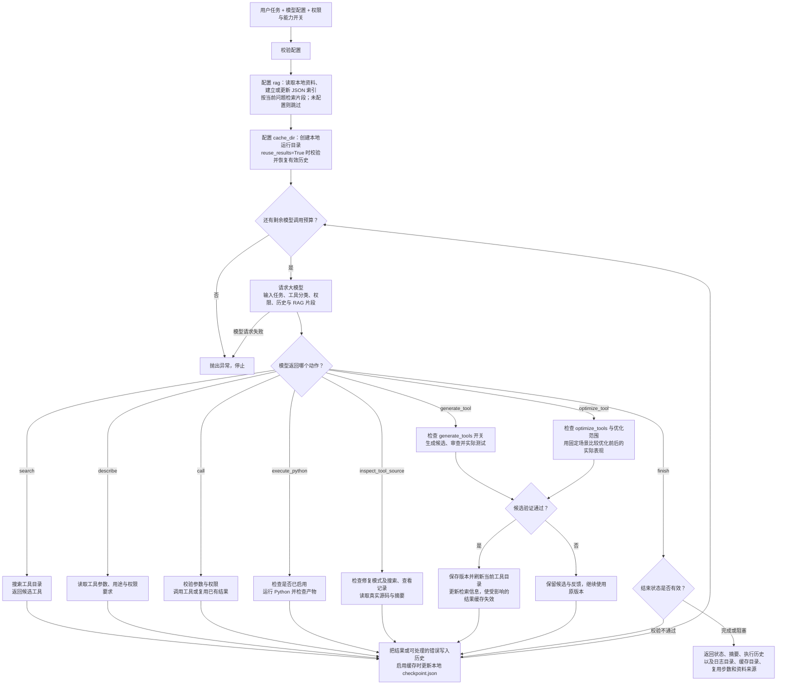

# Agent

DNAKit 内置 Agent 接收自然语言任务，由配置的大模型自动发现工具、查看参数、执行并汇总结果。还可按配置生成新工具、优化说明或兼容修复实现、复用本地结果缓存，以及检索用户指定的知识库资料后回答。通过 Python 调用 `dnakit.tools.run_agent()` 即可使用，无需启动 MCP，也无需安装 `dnakit[agent]` 可选依赖。

运行流程如下：每轮由大模型选择一个动作，执行结果反馈到下一轮决策。



<span id="agent-tool-calling"></span>

## 1) 快速开始

安装 DNAKit 核心包：

```bash
python -m pip install dnakit
```

在终端或 IDE 运行配置中设置模型名称与密钥。下例使用 DeepSeek，模型需要支持 JSON 模式；其他服务商及请求参数见 [Python API](python_api.md#custom-llm)。

```bash
export DNAKIT_LLM_MODEL="填写你账户可用的模型名称"
export DEEPSEEK_API_KEY="填写你的 API key"
```

### run_agent：自动执行任务

- **作用：** 接收自然语言任务，自动选择并调用 DNAKit 工具，返回结果摘要和执行记录。
- **处理方法：** 每轮将任务、权限、工具分类及历史交给大模型，解析一个 JSON 动作并执行，将观察结果用于下一轮决策，直到结束或达到步数限制。
- **API：** `dnakit.tools.run_agent(request[必须], config[必须], allow_side_effects[可选], max_steps[可选], registry[可选], search_mode[可选], search_limit[可选], code_execution[可选], cache_dir[可选], reuse_results[可选], rag[可选], generate_tools[可选], optimize_tools[可选], optimization_mode[可选], verbose[可选])`。
- **输入：** 必填任务文本和 `LLMConfig`；默认模型调用预算为 50 次、每次检索 5 个候选，默认关闭有副作用的操作、Python 执行、工具生成与优化。跨运行缓存和 RAG 也需显式配置。`verbose=True` 显示执行进度。
- **示例代码：** 先完成上面的模型与密钥配置，再运行：

```python
import os

from dnakit.llm import LLMConfig
from dnakit.tools import run_agent

config = LLMConfig(provider="deepseek", model=os.environ["DNAKIT_LLM_MODEL"])
request = "请计算 ACGT 的分子量，以及 AACG 的反向互补序列。"
result = run_agent(request, config=config, max_steps=50)
print(result.status)
print(result.text)
```

- **示例结果：** 以下仅示意成功执行后的末尾两行，省略默认进度信息；模型措辞及实际动作轮数可变，不代表固定响应。

```text
completed
ACGT 的分子量为 1173.84 Da；AACG 的反向互补序列为 CGTT。
```

默认使用 `search → describe → call`，根据实际结果继续执行或返回 `finish`。开启相应能力后，还可生成或优化工具、运行补充 Python；配置缓存后复用有效结果，配置 RAG 后先检索资料。默认输出每一步动作及调用的工具名称，便于查看进度。

需要写文件、下载数据或调用要求授权的工具时，在任务中明确目标位置，并显式开启 `allow_side_effects`：

```python
result = run_agent(
    "请下载人类 hg38 参考基因组 FASTA 到 data/hg38，不覆盖已有文件。",
    config=config,
    allow_side_effects=True,
)
print(result.text)
```

<span id="agent-actions"></span>

## 2) 功能与动作

当前提供八个模型动作，以及结果缓存、知识库检索两项运行能力。`search`、`describe` 和 `call` 同时提供可手动使用的 registry 接口；其余动作由 `run_agent()` 按调用方配置处理。缓存与 RAG 由运行器自动执行，不是模型可自行开启的 JSON 动作。API 签名中的 `[必须]`／`[可选]` 用于标记参数要求，不属于实际调用语法；以下示例中的 `config` 沿用快速开始的配置。

| 功能 | 入口或开关 | 用途 |
| --- | --- | --- |
| [检索工具](#agent-search) | `search` | 找到已注册的候选能力 |
| [查看参数](#agent-describe) | `describe` | 读取用途、参数与权限 |
| [调用工具](#agent-call) | `call` | 执行工具并检查结果 |
| [补充 Python](#agent-execute-python) | `execute_python`；`code_execution` | 执行当前任务需要的补充代码 |
| [生成新工具](#agent-generate-tool) | `generate_tool`；`generate_tools=True` | 验证并登记可复用的 Python/MCP 功能 |
| [读取源码](#agent-inspect-tool-source) | `inspect_tool_source`；修复模式 | 在修复前取得源码及版本摘要 |
| [优化工具](#agent-optimize-tool) | `optimize_tool`；`optimize_tools=True` | 优化描述，或按配置兼容修复实现 |
| [结束任务](#agent-finish) | `finish` | 返回完成状态或阻塞原因 |
| [结果缓存](#agent-result-cache) | `cache_dir`、`reuse_results` | 在本地文件夹保存结果并恢复有效步骤 |
| [知识库检索](#agent-knowledge-retrieval) | `rag=RAGConfig(...)` | 建立本地资料索引，先检索再交给模型回答 |

<span id="agent-search"></span>

### 1) Search：检索工具

- **作用：** 从已注册的工具目录中找到与任务相关的候选，返回工具名称、说明、分类等信息。
- **处理方法：** 默认按工具名称、描述和分类进行关键词匹配；语义模式使用 embedding 与余弦相似度，混合模式合并两种排名。此步骤不执行候选工具，也不搜索互联网。
- **API：** `AgentToolRegistry.search(query[可选], category[可选], limit[可选], include_python_only[可选], mode[可选])`；模型动作格式为 `{"action":"search","query":"功能关键词"}`。
- **输入：** 手动调用时 `query` 默认空字符串，表示列出工具；Agent 动作要求非空 `query`。直接调用默认 `limit=20`，Agent 使用调用方指定的 `search_limit`，默认 `5`。`mode` 可取 `keyword`、`semantic`、`hybrid`；后两种需配置 embedding 服务。
- **示例代码：** 以下关键词检索可离线运行，不需要模型密钥。

```python
from dnakit.tools import default_tool_registry

registry = default_tool_registry(verbose=False)
tools = registry.search("dnakit.thermodynamics.molecular_weight", limit=1)
print([tool.name for tool in tools])
```

- **示例结果：**

```text
['dnakit.thermodynamics.molecular_weight']
```

<span id="agent-describe"></span>

### 2) Describe：查看工具参数

- **作用：** 查看选定工具的参数结构、必填字段、用途及权限要求，为生成正确的调用参数提供依据。
- **处理方法：** registry 解析工具名称并返回完整描述。Agent 只允许查看本次任务已经搜索发现的工具，并记录它已被查看；手动调用 registry 不要求先搜索。
- **API：** `AgentToolRegistry.describe(name[必须])`；模型动作格式为 `{"action":"describe","tool_name":"完整工具名"}`。
- **输入：** 工具名称，建议使用 `search` 返回的完整名称。结果中的 `input_schema` 描述参数，`effect` 表示操作类型，`requires_confirmation` 表示是否要求调用方授权副作用。
- **示例代码：**

```python
from dnakit.tools import default_tool_registry

registry = default_tool_registry(verbose=False)
info = registry.describe("dnakit.thermodynamics.molecular_weight")
print(info["name"])
print(info["input_schema"]["required"])
print(info["effect"])
print(info["requires_confirmation"])
```

- **示例结果：**

```text
dnakit.thermodynamics.molecular_weight
['sequence']
local
False
```

<span id="agent-call"></span>

### 3) Call：执行工具

- **作用：** 使用明确的参数调用一个 DNAKit 工具，并返回可供模型读取或后续步骤使用的结果。
- **处理方法：** Agent 检查工具已被搜索和查看，解析参数中的 `$ref` 结果引用，再通过 registry 检查权限、转换参数并调用函数。同一任务中相同工具及参数复用已有观察结果，包括失败结果。直接调用 `registry.execute()` 不维护这些 Agent 历史与去重规则，也不解析 `$ref`。
- **API：** `AgentToolRegistry.execute(name[必须], arguments[可选], allow_side_effects[可选])`；模型动作格式为 `{"action":"call","tool_name":"完整工具名","arguments":{}}`。公开方法名为 `execute()`，没有 `registry.call()`。
- **输入：** 工具名称及符合其 Schema 的参数字典。手动调用省略 `arguments` 时使用空字典，Agent 动作必须提供该字段；文件写入、模型或外部进程等需要授权的工具要求 `allow_side_effects=True`，模型不能自行开启权限。
- **示例代码：** 此处直接调用分子量工具，不请求大模型。

```python
from dnakit.tools import default_tool_registry

registry = default_tool_registry(verbose=False)
result = registry.execute(
    "dnakit.thermodynamics.molecular_weight",
    {"sequence": "ACGT"},
)
print(round(result["value_dalton"], 2))
```

- **示例结果：**

```text
1173.84
```

<span id="agent-execute-python"></span>

### 4) Execute Python：补充代码执行

- **作用：** 当现有工具缺少某一步处理或无法直接交换数据时，让 Agent 编写并执行补充 Python，再继续使用结果。
- **处理方法：** 调用方启用后，运行器解析 `inputs` 中的结果引用并保存为 JSON，启动独立 Python 子进程，将输入文件路径作为 `sys.argv[1]` 传入。运行器检查退出码、超时和声明产物，返回输出或错误供模型调整；相同代码、输入和产物列表复用之前的观察结果。
- **API：** `execute_python` 是 `run_agent()` 内部动作，没有同名公开函数。公开配置入口为 `PythonExecutionConfig(workspace[必须], timeout_seconds[可选], max_attempts[可选], max_output_bytes[可选])`，通过 `run_agent(..., allow_side_effects=True, code_execution=配置)` 启用。
- **输入：** 动作必须包含 `reason`、`code`、`inputs`、`expected_outputs`；不写产物时设置 `expected_outputs=[]`。默认单次超时 120 秒、最多执行 5 次，stdout/stderr 各向模型返回末尾 16,000 字节。具体配置和日志见[补充执行与失败恢复](#python-execution)。
- **示例代码：** 以下为已启用 Python 执行时，模型可返回的动作示例；JSON 本身不是可直接调用的 Python 函数。

```json
{
  "action": "execute_python",
  "reason": "检查当前输入序列的长度",
  "code": "import json, sys\nwith open(sys.argv[1], encoding='utf-8') as stream:\n    data = json.load(stream)\nassert isinstance(data['sequence'], str)\nprint(len(data['sequence']))",
  "inputs": {"sequence": "ACGT"},
  "expected_outputs": []
}
```

- **示例结果：** 上述代码成功执行后返回的观察结果节选；目录、耗时等字段省略。

```json
{
  "ok": true,
  "result": {
    "status": "succeeded",
    "returncode": 0,
    "stdout": "4\n",
    "outputs": []
  }
}
```

<span id="agent-generate-tool"></span>

### 5) Generate Tool：生成可复用的新工具

- **作用：** 现有工具、MCP 或 Skill 的组合确实不能满足需求时，生成符合 DNAKit 规范的新函数，供后续 Python 和 MCP 调用。
- **处理方法：** 先检索已有能力，再提出输入输出契约、实现与固定测试。通过代码质量检查、独立审查和真实执行验证后，保存到 `dnakit.generated` 并刷新当前工具目录；失败候选保留反馈，不登记为可调用工具。
- **API：** `generate_tool` 是内部动作；调用方使用 `run_agent(..., generate_tools=True, allow_side_effects=True)` 开启。要求可写的 DNAKit 源码检出及已安装的开发检查器，不修改普通安装的 `site-packages`。
- **输入：** 动作包含 `name`、`reason`、`contract`、`code`、`tests`。凭据缺失、服务故障和参数错误不能直接视为功能缺口；不允许覆盖已有同名函数。
- **示例代码：** 开关允许按需生成，并不要求每个任务都创建新工具。

```python
result = run_agent(
    "完成当前 DNA 分析；仅在已有功能不能组合完成任务时生成可复用工具。",
    config=config,
    allow_side_effects=True,
    generate_tools=True,
)
print(result.text)
```

- **结果与产物：** 激活动作的 `observation.result` 包含 `tool_name`、`change_id`、`artifacts` 和验证记录。新函数可从 `dnakit.generated` 导入，MCP 使用同一完整工具名调用；同时准备回归测试、双语用法与本地 PR 草稿。源码入库、打包和人工提交方式见[工具开发详解](#agent-development)。

<span id="agent-inspect-tool-source"></span>

### 6) Inspect Tool Source：修复前读取源码

- **作用：** 获取已注册 DNAKit 函数的真实源码与摘要，为兼容修复确定原版本。
- **处理方法：** 先 `search`、`describe`，再读取当前源码检出内的对应定义。提出修复时必须携带这次读取的 `base_sha256`；源码发生变化后需重新检查。
- **API：** `inspect_tool_source` 由运行器处理，要求同时配置 `optimize_tools=True`、`optimization_mode="repair"`、`allow_side_effects=True`。
- **输入与示例：** 以下是模型动作；`tool_name` 必须是已经搜索并查看的完整名称。

```json
{
  "action": "inspect_tool_source",
  "tool_name": "dnakit.thermodynamics.molecular_weight"
}
```

- **结果：** 返回 `source`、`source_path`、`base_sha256`、函数名等信息，本动作不修改实现。它适用于本地 DNAKit 函数和此前生成的函数，不会下载或修改第三方 MCP 服务源码。

<span id="agent-optimize-tool"></span>

### 7) Optimize Tool：优化说明或兼容修复实现

- **作用：** 根据调用歧义或可复现缺陷，改进已有工具；适用范围由调用方指定。
- **处理方法：** 固定测试场景，记录原版表现，再验证候选；必须改善目标问题且保留已有成功场景，模型自评分不能代替执行验证。源码修复还需完成 `inspect_tool_source`。
- **API：** 通过 `run_agent(..., optimize_tools=True, optimization_mode=模式, allow_side_effects=True)` 开启，要求可写的 DNAKit 源码检出。与 `generate_tools` 相互独立，模型不能自行扩大范围。
- **输入与范围：**

| `optimization_mode` | 可优化的内容 | 保留的约束 |
| --- | --- | --- |
| `description_only`（默认） | DNAKit 工具说明、第三方 MCP 本地说明、Skill 用法与示例 | 实现和真实接口不变，Skill 的方法、阈值及流程含义不变 |
| `repair` | 本地 DNAKit 函数及已生成函数的缺失或错误行为；仍可显式选择仅优化说明 | 函数/MCP 名称、所有旧参数及返回接口不变，只能新增带默认值的关键字参数 |

- **示例代码：** 显式允许兼容修复；若只改说明，省略 `optimization_mode` 或设为 `"description_only"`。

```python
result = run_agent(
    "检查当前分析中出现的工具错误；仅在可复现时修复实现，并保持旧接口和成功用法。",
    config=config,
    allow_side_effects=True,
    optimize_tools=True,
    optimization_mode="repair",
)
print(result.text)
```

- **结果与产物：** 成功后返回 `change_id` 等版本记录并刷新工具描述、Schema 和检索信息；实现改变使相关结果缓存失效。失败时保持原版本。源码修复还生成测试、双语文档和 PR 草稿；第三方 MCP 当前只支持本地说明优化。回退与验收规则见[工具开发详解](#agent-development)。

<span id="agent-finish"></span>

### 8) Finish：结束任务

- **作用：** 返回任务完成状态及结果摘要，或明确说明阻塞原因，结束当前 Agent 循环。
- **处理方法：** 校验 `status` 和非空 `text`；声明 `completed` 时要求最近一次工具或代码调用成功，或有本次 RAG 检索证据支持直接回答。失败调用不能依靠此前检索证据宣称完成。`blocked` 不要求存在成功调用。正常结束时返回 `AgentResult`，启用 Python 执行或结果缓存时保存总结状态。
- **API：** `finish` 是 `run_agent()` 内部动作，没有独立的公开 `finish()` 函数；调用方通过返回对象的 `status`、`text`、`steps` 和 `execution_dir` 获取结果。
- **输入：** 必填 `status`（`completed` 或 `blocked`）及 `text`（非空总结）。达到步数上限和模型请求错误会抛出异常，不会自动转换为 `blocked`。
- **示例代码：** 假设此前已经成功计算 ACGT 的分子量，模型返回：

```json
{
  "action": "finish",
  "status": "completed",
  "text": "ACGT 的分子量为 1173.84 Da。"
}
```

调用方读取 `run_agent()` 的返回值：

```python
print(result.status)
print(result.text)
```

- **示例结果：** 对应上述动作；正常结束的 `finish` 本身不追加到 `result.steps`。

```text
completed
ACGT 的分子量为 1173.84 Da。
```

<span id="agent-result-cache"></span>

### 9) 结果缓存：保存本地文件并复用已完成步骤

- **作用：** 将执行历史和结果保存到指定文件夹；再次运行相同任务时，可继续使用已经完成且验证仍有效的步骤，不需要数据库。
- **处理方法：** 配置目录后逐步写入本地 `checkpoint.json`；开启复用时恢复有效历史，并校验工具定义、权限及可识别的文件输入输出。跨运行只复用成功结果，失败或失效步骤不当作已完成。
- **API：** `run_agent(..., cache_dir="./agent_cache", reuse_results=True)`。默认 `cache_dir=None` 不持久化，`reuse_results=False` 表示从头运行并保留旧记录。
- **示例代码：** 中断后使用同一个 `request` 和缓存目录再次执行。

```python
request = "请计算 ACGT 的分子量，以及 AACG 的反向互补序列。"
result = run_agent(
    request,
    config=config,
    cache_dir="./agent_cache",
    reuse_results=True,
)
print(result.reused_steps)
print(result.cache_dir)
```

- **结果：** 若前 3 个工具或 Python 调用的成功记录均通过校验，`reused_steps` 会计入这些调用；没有可复用历史时为 `0`。大文件保留在原输出位置，缓存记录其路径及摘要。完整规则、目录布局和中断边界见[结果缓存详解](#agent-cache)。

<span id="agent-knowledge-retrieval"></span>

### 10) 知识库检索：指定资料目录，先检索再回答

- **作用：** 使用用户自己的本地资料回答问题，或为后续分析提供依据。
- **处理方法：** 将资料放入目录后，DNAKit 读取和分块、建立或更新本地 JSON 索引，在本次 `run_agent()` 首次模型决策前按问题检索。命中片段及来源作为上下文交给模型，后续各轮沿用这批片段。
- **API：** `run_agent(..., rag=RAGConfig(directory="./knowledge", index_dir="./knowledge_index"))`。`rag=None` 默认关闭；关键词检索在本地执行，语义和混合模式需单独配置 embedding。
- **示例代码：** 先把 UTF-8 文本资料放入 `./knowledge`。

```python
from dnakit.tools import RAGConfig

result = run_agent(
    "根据实验室资料说明 FASTQ 质控的验收条件，并注明来源。",
    config=config,
    rag=RAGConfig(directory="./knowledge", index_dir="./knowledge_index"),
)
print(result.text)
for hit in result.knowledge_context:
    print(hit["source"], hit["chunk_id"])
```

- **结果：** `knowledge_context` 返回命中片段及来源；资料足够时模型可据此直接回答，没有命中时不能把空结果当作回答依据。RAG 检索资料，`search` 检索工具，两者分别配置。资料格式、索引位置与检索参数见[知识库检索详解](#agent-rag)。

<span id="agent-files"></span>

## 3) 自动补齐下载地址与文件衔接

自然语言任务可以只给数据集名称、子任务和目标目录。`run_agent()` 已在每一步调用
`call_llm()` 决定动作；缺少 URL 时，模型可以查找以下通用工具：

| 工具 | 用途 |
| --- | --- |
| `dnakit.search.web_search` | 搜索互联网，返回候选页面的标题、URL 和可用摘要 |
| `dnakit.search.read_webpage` | 读取 HTTPS 网页或文本/JSON API，返回正文片段与实际链接 |
| `dnakit.download.download_url` | 将确认的文件直链下载到指定目录 |

Agent 的 `search` 动作仍只检索工具目录。网页搜索默认在设置 `TAVILY_API_KEY` 时使用
Tavily，否则使用 DuckDuckGo HTML，无需额外 Python 依赖。也可通过 `provider` 显式选择。
搜索密钥只从进程环境读取，不传给模型。DuckDuckGo 返回验证码时工具会报错，不会把它
当作空搜索结果；可配置 Tavily，或用网页读取工具核实模型已知的候选页面。
网页和搜索结果是数据，不能覆盖用户任务；工具不运行网页脚本，也不生成未经观察的直链。

```python
from dnakit.search import read_webpage, web_search

candidates = web_search("NT revised H2AFZ dataset")
page = read_webpage(candidates.records[0]["url"], match="H2AFZ")
print(page.to_dict())
```

`read_webpage` 默认返回最多 8,000 个正文字符与 30 个链接；`match` 可按关键词筛选，
`offset` 和 `link_offset` 可翻页，结果明确提供截断标记及下一页位置。
二进制文件交给下载工具。`call_llm(file_path=...)` 继续只负责理解本地文本文件。

现有机器学习训练接口支持 `CustomPropertyTrainingConfig(cv_folds=10, ...)`：对单个
训练文件执行完整 K 折验证，保存每行验证折、折外预测和验证指标，再用全部训练数据
拟合最终模型。此模式仅支持 `finetune_method="machine_learning"`，忽略三份划分比例，
拒绝映射的 split 列；独立 test 留给后续预测。每折的标准化和模型都只拟合该折训练行。
`predict_custom_properties(..., output_path="predictions.csv")` 可直接保存预测标签，
其 `to_dict()`/Agent 返回值只含文件摘要；Python 对象仍保留原有预测与概率属性。
CSV 可以交给 `plot_csv_distributions`，再调用 `save_image` 保存图。

Agent 的 `call` 参数支持引用之前成功调用的结果，例如
`{"artifact": {"$ref": {"step": 12, "path": ["label"]}}}`。`step` 是历史中的
轮次编号（从 1 开始），`path` 是结果中的键/列表索引路径，空路径代表整个结果。
引用在本地解析，适合传递绘图对象等内容，模型无需重新生成 SVG 或复制大量数据。
常规 `registry.execute()` 不解释这种 Agent 引用。

自动识别数据字段时，内置读取器会检查候选 ID 列是否唯一；重复名称改用稳定的源文件
行号 ID，保留全部样本并记录说明。用户明确设置的 `DataMapping.id_field` 仍严格校验。

<span id="python-execution"></span>

## 4) 通用 Python 补充执行与失败恢复

工具不能直接衔接时，可以让同一个 Agent 编写并执行 Python，完成格式转换、窗口抽样、
表格合并等缺失步骤，再继续调用已有工具。调用方通过 `code_execution` 显式开启：

```python
from dnakit.tools import PythonExecutionConfig, run_agent

result = run_agent(
    request,
    config=config,
    allow_side_effects=True,
    code_execution=PythonExecutionConfig(
        workspace="agent-output",
        timeout_seconds=600,
        max_attempts=5,
    ),
)
print(result.text)
print(result.execution_dir)  # 本次运行独立的代码及日志目录
```

开启后，模型优先使用已有工具；发现能力缺口或收到报错后，可以选择 `execute_python`
运行时动作。模型提供 `reason`、完整 `code`、`inputs` 和 `expected_outputs`。
`inputs` 支持 `$ref`，在本地解析后保存为 JSON，脚本通过 `sys.argv[1]` 读取，避免把
预测数组、序列或 SVG 重新抄进代码。后续工具也可以引用执行结果中的文件路径。

运行器使用当前 Python 解释器启动独立子进程。非零退出码、超时或声明的产物缺失/为空
都会作为失败反馈给模型；模型可依据 stderr 修改代码再次执行。相同代码、输入和产物列表
不会重复执行。检查脚本也计入 `max_attempts`，所有动作仍受 `max_steps` 限制。
默认单次超时 120 秒、最多执行 5 次，返回给模型的 stdout/stderr 各保留末尾 16,000 字节；
完整输出在磁盘上。POSIX 系统会在超时、打断和脚本退出时清理同一进程组的子进程；
Windows 仅终止直接启动的 Python 进程。

日志位于 `<workspace>/.dnakit_agent/run_*/`：

- `history.jsonl`：工具调用、补充代码动作及其观察结果，包括失败。
- `summary.json`：结束状态及实际代码执行次数；这些自动尝试不等于人工介入。
- `attempt_*/script.py`、`inputs.json`、`request.json`：实际代码、解析后的输入、补充原因及产物路径。
- `attempt_*/stdout.log`、`stderr.log`、`result.json`：完整输出、报错、退出码、耗时和文件检查。

这是本地执行能力，**不是安全沙箱**：代码拥有当前用户的文件、网络和环境权限，
`workspace` 只是工作目录。默认关闭，并要求调用方设置 `allow_side_effects=True`。
文件存在检查不能替代科学结果验证；模型应在代码中检查行数、字段、序列长度等任务条件。
缺少凭据、依赖或外部资源时仍可能停止，不能保证任意任务都自动完成。

<span id="tool-search-modes"></span>

## 5) 配置工具检索

默认关键词检索无需 embedding 服务。如需语义或混合检索，先按 [Python API 的检索配置](python_api.md#tool-search-modes)设置独立的 embedding 环境变量，再创建 registry：

```python
from dnakit.tools import AgentToolRegistry, EmbeddingConfig

registry = AgentToolRegistry(embedding_config=EmbeddingConfig(
    model=os.environ["DNAKIT_EMBEDDING_MODEL"],
    base_url=os.environ["DNAKIT_EMBEDDING_BASE_URL"],
))
```

将这个 registry 传给 `run_agent()`，沿用快速开始中的聊天模型 `config`。聊天模型负责选择工具和生成参数，embedding 模型负责检索向量：

```python
from dnakit.tools import run_agent

result = run_agent(
    "请计算 ACGT 的分子量。",
    config=config,
    registry=registry,
    search_mode="hybrid",
    search_limit=10,
)
print(result.text)
```

`run_agent()` 默认 `search_mode="keyword"`、`search_limit=5`；候选数量可设为 1–100，模型不能修改调用方选定的模式或限额。`max_steps=50` 限制本次聊天模型调用总次数，包含开发审查和描述验证，不包含独立的 embedding API 请求。上例会执行选中的分子量计算工具。

<span id="agent-cache"></span>

## 6) 本地结果缓存与断点续跑

在 `run_agent()` 上配置缓存，无需修改工具或启动数据库：

```python
result = run_agent(
    "处理 samples.fasta，先计算统计，再导出报告到 results/。",
    config=config,
    allow_side_effects=True,
    cache_dir="./agent_cache",
    reuse_results=True,
)
print(result.reused_steps)
print(result.cache_dir)
```

- `cache_dir=None`：不启用跨运行缓存。
- 指定 `cache_dir`、`reuse_results=False`：从头执行并逐步保存；保留旧运行目录。
- 指定 `cache_dir`、`reuse_results=True`：恢复相同任务文本、当前工作目录及 Python workspace 下最近一次运行的有效历史；没有历史时正常开始。

每个动作完成后原子写入本地 `checkpoint.json`，其中包含历史、已完成结果和验证信息。缓存目录按任务分组，每次运行使用独立子目录。RAG 检索到的资料内容也参与任务指纹，证据变化后不会复用基于旧资料的历史。工具产生的大文件仍保留在原输出位置，缓存记录路径与指纹，不重复复制整个数据集。

```text
agent_cache/
└── agent_runs/
    └── <任务摘要>/
        └── run_<时间>_<随机值>/
            └── checkpoint.json
```

`result.cache_dir` 指向本次 `run_...` 子目录。缓存和 RAG 可用于普通安装环境；写入这些运行记录或索引本身不要求 `allow_side_effects=True`。任务中实际调用的工具仍各自校验权限。工具开发的源码、差异和回退备份另存于源码检出的 `.dnakit/development/`，不与执行结果缓存混用。

例如已成功完成第 1、2、3 步，第 4 步失败或下一轮模型请求中断，再次运行相同请求时，模型会先看到已恢复的历史，继续使用原步骤编号和 `$ref`。失败记录保留用于诊断，但跨运行只复用成功结果，失败步骤可以修正后重试。`max_steps` 是本次新增决策预算，历史步骤不占用它。缓存不会直接返回旧的最终回答，模型仍会检查历史并继续或总结。

恢复时检查工具定义、当前权限及可识别输入/输出文件；某一步失效后，丢弃该步及其后的全部历史，只保留之前的有效前缀，不会单独挑选后续无关步骤恢复。输出被删除或修改时不复用旧路径。Python 步骤要求再次显式启用执行功能，校验声明输入、产物及审计文件；代码隐式读取的文件、远程状态或依赖环境变化不能完全自动识别，需要重新运行时设置 `reuse_results=False`。

正在执行的动作会先记为 `pending`。如果进程在执行与保存结果之间中断，该动作的结果会标为未知，不能作为成功结果，也不会自动重放完全相同的调用。先检查实际产物；明确需要重跑时使用 `reuse_results=False`。结果缓存不承诺任意外部操作恰好执行一次，也不替代 `allow_side_effects`。

<span id="agent-rag"></span>

## 7) 指定本地资料目录，先检索再回答

将 UTF-8 文本资料放入自己的目录，用 `RAGConfig` 指定。DNAKit 负责读取、分块、保存文件索引，并在首次模型决策前检索相关片段：

```python
from dnakit.tools import RAGConfig, run_agent

result = run_agent(
    "根据实验室资料，说明 FASTQ 质控的验收条件，并注明来源。",
    config=config,
    cache_dir="./agent_cache",
    reuse_results=True,
    rag=RAGConfig(
        directory="./knowledge",
        index_dir="./knowledge_index",
        mode="keyword",
        top_k=5,
    ),
)
print(result.text)
for hit in result.knowledge_context:
    print(hit["source"], hit["chunk_id"], hit["text"])
```

默认关键词检索在本地运行，不调用 embedding 服务。支持 UTF-8 的 `.txt`、`.md`、`.markdown`、`.rst`、`.json`、`.jsonl`、`.csv`、`.tsv`、`.yaml`、`.yml`，均作为文本处理；PDF、Word 或扫描图片应先转换为文本。隐藏文件/目录、符号链接与不支持的格式会跳过。索引使用 JSON 文件，不使用数据库；资料内容变化后更新索引。扫描与索引有文件数量、文件大小、总大小、分块数量和上下文长度限制，默认显示进度。

| `RAGConfig` 参数 | 默认值与用途 |
| --- | --- |
| `directory` | 必填，用户提供的本地资料目录 |
| `index_dir` | 可选，JSON 索引目录；不能与资料根目录相同 |
| `mode` | `"keyword"`；也可配置 `"semantic"`、`"hybrid"` |
| `embedding_config` | 默认 `None`；语义和混合模式必须显式提供 |
| `top_k` | `5`，最多返回的片段数 |
| `chunk_size` / `chunk_overlap` | `1200` / `150`，分块字符数与相邻块重叠字符数 |
| `max_context_chars` | `12000`，返回给模型的资料文本总字符预算 |

显式指定 `index_dir="./knowledge_index"` 时，索引保存在该目录下的 `index-<资料目录摘要>.json`。未指定时使用 `$XDG_CACHE_HOME/dnakit/knowledge/<资料目录摘要>/`，未设置 `XDG_CACHE_HOME` 则从 `~/.cache` 开始。每次运行按源文件内容摘要检查新增、删除和修改；检索在首次模型决策前执行一次，后续决策继续使用本次命中的片段。

`rag.mode` 可设为 `semantic` 或 `hybrid`，同时显式提供 `embedding_config=EmbeddingConfig(...)`，配置方式见 [Python API](python_api.md#tool-search-modes)。RAG 与工具检索分别配置；不会自动使用聊天模型作 embedding。语义检索会把查询和资料分块发送给选定的 embedding 服务；所有模式都会把选中的资料片段发送给聊天模型。返回片段包含来源和分块编号，提示模型据此引用；资料中的文字按参考数据处理。

资料足以回答时允许直接结束，不必调用科学工具。没有相关片段时，不会把空检索结果视为完成证据。任务要求实际分析或产出文件时，模型仍需执行相应步骤。

命令行示例读取 `DNAKIT_LLM_MODEL`、`DNAKIT_LLM_API_KEY`，可选 `DNAKIT_LLM_PROVIDER` 和 `DNAKIT_LLM_BASE_URL`。以下命令复用同一任务的结果，并检索本地资料：

```bash
python others/examples/run_agent_with_memory.py \
  --request "根据实验室资料，说明 FASTQ 质控的验收条件，并注明来源。" \
  --cache-dir ./agent_cache \
  --reuse-results \
  --rag-dir ./knowledge
```

去掉 `--reuse-results` 即从头执行并保存新结果；不传 `--rag-dir` 即关闭 RAG。

<span id="agent-results"></span>

## 8) 执行限制与返回结果

| 参数 | 默认值与用途 |
| --- | --- |
| `config` | 必填的 `LLMConfig`，指定聊天模型、接口与凭据 |
| `max_steps` | `50`，本次模型调用总预算，包含工具开发审查和描述验证决策 |
| `allow_side_effects` | `False`，需要文件、模型或进程操作时由调用方显式授权 |
| `code_execution` | `None`，传入 `PythonExecutionConfig` 后启用本地 Python 执行 |
| `search_mode` / `search_limit` | `keyword` / `5`，工具检索方式与候选数量 |
| `cache_dir` / `reuse_results` | `None` / `False`，本地 JSON 缓存目录与历史结果复用开关 |
| `rag` | `None`，传入 `RAGConfig` 后先检索本地资料 |
| `generate_tools` / `optimize_tools` | 均为 `False`，分别允许生成新功能、优化已有工具 |
| `optimization_mode` | 默认 `"description_only"`；`"repair"` 允许兼容性修复本地 DNAKit 实现 |
| `verbose` | `True`，显示动作进度及工具调用 |

返回的 `AgentResult` 包含：

- `text`：模型汇总的结果或阻塞原因。
- `status`：`completed` 或 `blocked`。完成须有执行或 RAG 证据支持，但不代表整个任务已通过独立验证。
- `steps`：动作及观察结果，包括失败记录。
- `execution_dir`：启用 Python 执行时的代码与日志目录，否则为 `None`。
- `cache_dir`：本次运行的缓存子目录，否则为 `None`。
- `reused_steps`：从历史恢复的成功工具/Python 调用数量。
- `knowledge_context`：本次 RAG 检索到的资料片段及来源。

未配置 `cache_dir` 或 `code_execution` 时，历史仅在内存中返回。断点恢复针对相同请求，不会自动提炼跨任务偏好或经验。达到 `max_steps` 仍未结束会抛出错误；模型或网络错误直接向上传递，不自动重试。工具参数说明、执行结果和选中的 RAG 资料会发送给配置的模型服务。

直接调用大模型或手动查询工具见 [Python API](python_api.md)；连接其他 Agent 客户端见 [MCP](mcp.md)；查找分析工作流见 [Skills](skills.md)。

<span id="agent-development"></span>

## 9) 工具生成、源码修复与说明优化

两个开关相互独立，要求 `allow_side_effects=True`，并从可写的 DNAKit 源码检出运行（例如 `python -m pip install -e .`）。普通安装环境不改写 `site-packages`。

```python
result = run_agent(
    "完成这项分析；遇到已有工具无法处理的功能缺口时创建可复用函数。",
    config=config,
    allow_side_effects=True,
    generate_tools=True,
    optimize_tools=True,
    optimization_mode="repair",
    cache_dir="./agent_cache",
    reuse_results=True,
    rag=RAGConfig(directory="./knowledge"),
)
```

Agent 先检索已有能力，再按实际缺口提交 `generate_tool`，或按缺陷、功能不完整及说明歧义提交 `optimize_tool`。开关和优化范围由运行器检查，模型不能自行扩大。缺凭据、服务故障和参数错误不能直接当成功能缺口。

生成候选包含输入输出 JSON Schema、依赖、操作效果、验收条件、代码与固定输入/预期输出测试。独立模型审查、静态检查和当前解释器的实际子进程测试全部通过后，函数写入 `src/dnakit/generated/<名称>_<内容摘要>.py`，并登记到 `manifest.json`。当前 Agent 保留原 registry 筛选、序列化限制和 embedding 配置，仅加入这个新函数；调用前仍须读取参数说明。

```python
# new_function 是生成动作返回的具体函数名。
from dnakit.generated import new_function

result = new_function(...)
```

现有 MCP 的 `describe_dnakit_tool`、`call_dnakit_tool` 使用 `dnakit.generated.new_function` 调用同一实现。独立 MCP 进程重启后载入，其他安装环境需要安装更新的 DNAKit 包及该函数声明的依赖。构建包包含生成模块、manifest 和描述元数据；不会自动发布 PyPI。候选只能使用已安装依赖，`contract.dependencies` 使用 Python 顶层模块名（如 `numpy`），不自动安装或修改项目依赖。第三方依赖在函数内导入；另一个环境缺少依赖时，该工具标记为不可调用，不影响其余工具。验证子进程默认限制为 30 秒，工作目录隔离不等于安全沙箱。

新工具沿用 DNAKit 的类型注解、英文 docstring、`__all__` 导出、`verbose=True` 反馈、长任务进度及异常约定。生成流程进行 Ruff 格式化、Lint 和严格 Mypy 检查；缺少检查器时保留候选，不激活。请先显式安装开发依赖 `python -m pip install -e '.[dev]'`。

`optimization_mode="repair"` 允许修复当前源码检出内的 DNAKit 函数，包括此前生成的函数。Agent 必须先检索、读取接口，再通过 `inspect_tool_source` 读取真实源码及摘要，随后提出同名函数的完整替换定义。无需重新下载 DNAKit；发现源码在检查后变化时拒绝覆盖。

源码修复保持函数名、公开导入路径、MCP 名称，以及旧参数的名称、顺序、类型、默认值和调用方式不变；只可新增有默认值的关键字参数，保持返回接口。新导入放在函数内部，不改动模块其他函数。固定用例先运行原实现、再运行候选；须保留原有成功场景并证明缺陷已修复或新增可选功能可用。基线因缺依赖、服务故障或执行超时无法验证时，不激活。独立审查与测试仅证明所覆盖场景。

激活后当前 Agent 刷新目标函数及 Schema，保留工具筛选、权限和 embedding 配置；源码改变使相关结果缓存失效。第三方 MCP 的真实服务源码修复尚未接入：本版只优化其本地描述层。获取上游源码、修改本地副本与让远端服务运行新实现是不同步骤，需要明确仓库版本、许可证及可验证的服务环境。

生成或修复成功后，一并准备以下投稿文件：`others/tests/generated/` 的固定回归测试、`docs/llm_tools/generated/` 的中英文 Python/MCP 示例，以及 `registry/contributions/<change_id>.json` 和同名 `.md` PR 草稿。涉及外部服务、文件写入或本机绝对路径的测试默认跳过，审查后用 `DNAKIT_RUN_GENERATED_EFFECT_TESTS=1` 显式运行。公开元数据不保存本机审计路径；`.dnakit/` 中的日志与备份被 Git 忽略。用户检查材料后自行提交 GitHub PR，由维护者决定 merge；Agent 不自动执行 Git 提交、推送或创建 PR。投稿规范见仓库根目录 `CONTRIBUTING.md`。

默认 `optimization_mode="description_only"` 保留原有说明优化。修复模式也可针对说明问题显式选择该范围，支持三类目标：

| 目标 | 保存位置与约束 |
| --- | --- |
| DNAKit 工具 | `src/dnakit/tools/_data/descriptions.json`；改描述、参数解释和示例，保留类型、默认值、效果权限及实现 |
| 第三方 MCP | 同一文件中的本地说明层；上游真实名称、Schema 约束和调用保持不变，上游契约变化后旧覆盖层失效 |
| Skill | 源码中的 `SKILL.md` 或 `DNAKIT.md`，同步 `registry/catalog.json` 的摘要、大小和 SHA-256；保留来源与许可证 |

固定场景包括使用请求、期望参数和期望结果。评估模型分别只看旧版或候选说明，不接收期望答案或完整开发历史。选错工具或参数时记录失败，避免执行错误操作；选择正确时实际调用并核对结果。只有至少一个失败改善、原有成功场景无退化才激活。Skill 还检查命令、代码块、数值阈值和来源等不变，并进行模型语义审查。这些验证只覆盖固定场景，不代表对所有科学场景的正确性证明。

每个候选以目标和修改原因识别，最多修订三轮，测试和契约在修订间固定；修改代码或说明后再提交同一候选。审查和场景评估也消耗 `max_steps`。暂存、验证、激活状态、代码/说明差异及回退备份写入源码检出的 `.dnakit/development/<change_id>/`；即使没有 `cache_dir` 也保存开发记录。默认显示阶段和验证进度。

恢复时可复用已验证的激活回执，避免重复创建或执行测试；验证被中断且结果不明确时保留候选供检查，不自动重跑。当前运行中，工具更新会移除受影响调用的缓存；跨运行恢复遇到文件、回退或接口变化时，只保留首个失效步骤之前的有效历史。描述更新后重新建立工具检索目录，语义检索按新文本更新向量。RAG 保持每次启动先检索资料的流程。

从 `result.steps` 中开发动作的 `observation.result.change_id` 获取版本标识，回退示例：

```python
from dnakit.tools import rollback_tool_change

rollback_tool_change(change_id, allow_side_effects=True)
```

回退前核对文件摘要；存在后续重叠修改时拒绝覆盖，应按相反顺序回退。Python 中已经持有的旧函数对象或旧 registry 不会被原地替换，重新获取默认 registry；独立 MCP 进程同样需要重启。

命令行开启工具生成和兼容性源码修复，同时恢复缓存、检索本地资料：

```bash
python others/examples/run_agent_with_memory.py \
  --request "完成指定分析，必要时生成缺少的函数或修复已有函数的缺陷，并保留旧接口。" \
  --allow-side-effects \
  --generate-tools \
  --optimize-tools \
  --optimization-mode repair \
  --cache-dir ./agent_cache \
  --reuse-results \
  --rag-dir ./knowledge \
  --max-steps 50
```
