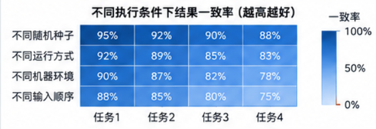
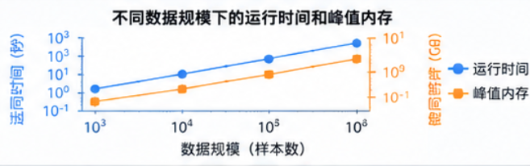
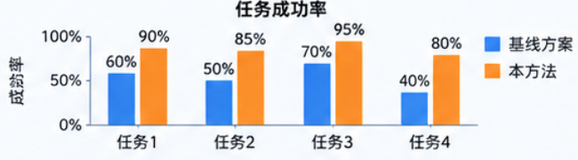

# fig1：

模型架构+功能图

# table1：

本表比较 DNAKit 与现有软件的**功能覆盖**，保持 9 个功能列。描述符按固定 schema 字段、模型按登记条目、算法/统计指标按具体定义、其他能力按独立公开操作计数。为覆盖当前项目，将“序列分析”扩展为“序列分析与分子设计”，“描述符与指纹”扩展为“描述符、指纹与特征工程”，“Agent 工具调用”扩展为“工作流、工程与Agent”。每个计数条目只归一列，九列之和为本表总数。

| 工具             | 序列获取与预处理 | 序列分析与分子设计 | 描述符、指纹与特征工程 | 数据集构建 | DNA大模型 | 性质预测与建模（DNA注释） | 序列集合评价 | 可视化   | 工作流、工程与Agent | 总共的功能数量 |
| ---------------- | ---------------- | ------------------ | ---------------------- | ---------- | --------- | ------------------------- | ------------ | -------- | ------------------- | -------------- |
| Biopython        |                  |                    |                        |            |           |                           |              |          |                     |                |
| SeqKit           |                  |                    |                        |            |           |                           |              |          |                     |                |
| scikit-bio       |                  |                    |                        |            |           |                           |              |          |                     |                |
| UGENE            |                  |                    |                        |            |           |                           |              |          |                     |                |
| iLearnPlus       |                  |                    |                        |            |           |                           |              |          |                     |                |
| iFeatureOmega    |                  |                    |                        |            |           |                           |              |          |                     |                |
| seqme            |                  |                    |                        |            |           |                           |              |          |                     |                |
| pydna            |                  |                    |                        |            |           |                           |              |          |                     |                |
| DNA Chisel       |                  |                    |                        |            |           |                           |              |          |                     |                |
| **DNAKit** | ✓（94）         | ✓（160）          | ✓（317）              | ✓（40）   | ✓（11）  | ✓（127）                 | ✓（32）     | ✓（12） | ✓（23）            | （816）        |

表注与统一计数规则：

- `✓（n）` 表示按该列口径已核实 n 个能力条目；`–（0）` 仅用于已核实不存在纳入范围内能力的情况。空白或“待核实”表示尚未核实，不能作为 0；其他软件行暂留空。
- **计数单位按各列明确登记：描述符每个固定 schema 字段计 1 项，DNA 编码每种方法计 1 项，embedding 每个模型计 1 项，预测每个“模型:任务”计 1 项，机器学习每种算法族计 1 项。** 其他可选算法、划分/变换策略和不同定义的统计指标逐项计数，独立公开操作也逐项登记。每项有唯一 ID、类别、公开接口与范围说明，`count=1`；排除的分发/支撑步骤为 `count=0`。数量是此明确口径下的能力条目数，不表示数学独立的特征数或源码函数数。
- **不再把多种命名方法统一压成一个任务族。** 例如 MAFFT/MUSCLE/Clustal Omega、NJ/UPGMA、PERMANOVA/ANOSIM/PERMDISP、PCA/t-SNE 等分别登记。兼容别名、输入/格式包装、数据库提供方、线程数、阈值、窗口大小、维数、训练/推理阶段和参数组合不乘计。同一个机器学习算法的分类器与回归器仍合计 1 项。命名方法改变处理规则时可单列；仅改变作用范围或数值参数不单列。
- 读与写、训练与性能评价等不同操作可分别计数。同一个登记预测任务支持的 sequence/pair/variant 输入合计 1 项，54 个任务覆盖全部 66 个输入绑定，不再额外加一个“轨道变异效应预测”总项。全量微调和线性探测各计 1 项，包含分类/回归及重载推理；机器学习分支按 37 类算法计数，不再追加通用分类/回归训练包装。多分类标签、输出轨道数和 embedding 维数不拆计。
- **同一方法的跨入口包装合并，跨步骤依赖不追加计数。** 神经 embedding 聚类中的 KMeans 与普通 KMeans 合并；PCoA 快捷入口合并；Manhattan/cityblock 合并；Jaccard、cosine 等在序列向量、指纹、Sketch、群落丰度入口间合并。标准化/低方差筛选在多个接口中只计一次。同一统计名用于不同目标且定义/产物不同的任务可分列，例如分类 precision 与 PRDC 几何 precision。被 Agent 调用的生物学能力不再计入 Agent 列。
- **总共的功能数量 = 九个功能列的数量之和。** 总数由逐项清单汇总，不先各列重复统计再在总数中扣除；本表不再采用“总数可能小于列之和”的旧口径。

各列的核实口径（互斥归属）：

- **工具**：固定代码版本、工作区状态和安装范围。DNAKit 本次核对日期为 **2026-09-09**，包版本 **0.1.3**，Git 基线 **f583bb3**，包含当前未提交实现，不能当作该提交或已发布包单独拥有的功能。比较其他软件时也须记录版本、依赖和可选后端。
- **序列获取与预处理（A）——94 项**：已有数据的发现、查询、下载、读写、格式/索引访问、元数据管理、合法性检查、字符/Gap 标准化、坐标转换、序列编辑与分块。FASTA/FASTQ 索引各计一项；BLAST、BWA、Bowtie2、minimap2、samtools-dict 专用索引各计一项，samtools-fai 并入 FASTA 索引。fixed/sliding/random/multiscale/curriculum 分块共 5 项；排序与打乱各一项，排序键不拆计；ABI 解码与 Mott 修剪各一项；补入按 ID/输入位置选择内存记录。已有注释/变异数据获取归 A，计算新注释归 F；合法性单条/集合包装合并在 A。不同文件格式和数据库提供方不按名字增计。
- **序列分析与分子设计（B）——160 项**：序列变换、匹配、比对、距离与最近邻、模式识别、统计推断、系统发育、测序分析和分子设计。展开 3 种成对比对、5 种 BLAST 搜索、2 种 HMM 搜索、3 种多序列比对、2 种建树、2 种 reads 比对、4 种组装、3 种文库、3 种距离置换检验、2 种 Mantel、4 种排序、6 种组成正/逆变换、ANCOM/ANCOM-BC 与 4 种 alpha 多样性。9 类相似度/距离方法已合并跨入口别名。序列优化按 19 种原生规则、BLAST 匹配约束和接受自定义规则的求解入口计 21 项；规则参数和优化迭代数不相乘，固定长度求解不等于能改变长度。分子量、消光系数、Tm、堆积贡献仍归 C 的描述符字段；B 保留双序列稳定性、校正、局部 Tm、平衡/熔解曲线、结构、双链减色/修饰及光学量纲换算。实验 reads 的 RNA-seq 定量/差异表达归 B，模型预测归 F。
- **描述符、指纹与特征工程（C）——317 项**：**240 个固定描述符字段 + 44 种 DNA 编码 + 13 项其他描述/指纹操作 + 2 种 Sketch + 6 种预处理 + 12 种特征分析**。13 项为重复段坐标、滑窗描述、逐密码子谱、整数编码和 9 项指纹；MinHash/FracMinHash 分开；预处理包括 standard/minmax/l1/l2 与均值/零填补；特征分析包括 PCA、t-SNE、监督 LDA、Latent Dirichlet、variance、chi2、f_classif、f_regression、两种 mutual_info、information_gain、Pearson。none/error 不产生新变换，variance 合并预处理器的低方差过滤。原长度/GC/CpG/熵/复杂度/综合向量包装不再加计，旧 Kmer/one-hot/NAC 入口并入对应编码。固定字段与可配置编码方法分别登记，向量维数不再乘计，不宣称数学独立。二核苷酸理化字段需要用户提供数值表，缺表时返回不可用原因。聚类归 D，embedding 归 E。
- **数据集构建（D）——40 项**：**6 种去重规则 + 14 种聚类算法 + 5 种代表选择 + 8 种划分 + 3 种区间操作 + 4 项其他能力**。去重为 exact/RC/circular/circular-RC/IUPAC/approximate；聚类为贪心阈值、single/complete/average 层次聚类和 KMeans、MiniBatchKMeans、DBSCAN、Spectral、AffinityPropagation、MeanShift、Ward agglomerative、Birch、GMM、MCL；神经聚类并入 KMeans，不乘 embedding 数。代表选择为 first/shortest/longest/best_quality/medoid；划分为 random/hash/stratified/group/similarity/temporal/joint/preassigned。区间并/交/差各一项；另外保留泄漏检测、划分质量评价、版本化参考集合、Sketch 索引构建与持久化。度量、阈值和簇数不与算法相乘，已在 B/C/E 登记的依赖不重复追加。
- **DNA大模型（E）**：每个已接入的 embedding 模型计 1 项，当前共 **11 项**：AlphaGenome、Caduceus、DNABERT-2、Enformer、Evo 2、GENERator、GROVER、HyenaDNA、JanusDNA、LucaOne、Nucleotide Transformer v2。以 `available_embedding_models()` 的规范模型名逐项绑定清单。模型及能力发现、基础/任务 checkpoint 获取与定位、表征提取接口属于共享支持能力，不在 11 项之外追加计数；模型别名、checkpoint 版本及 pooling/batch/device 参数不拆计。任务头预测、变异效应、全量微调、线性探测和机器学习训练统一归 F；模型驱动的聚类归 D，Fréchet 距离归 G。
- **性质预测与建模（DNA注释）（F）——127 项**：**54 个预测任务 + 37 类机器学习算法 + 2 种深度训练方法 + 5 项注释 + 29 类性能指标/混淆矩阵**。54 个“模型:任务”覆盖全部 66 个输入绑定，同任务的普通/配对/变异输入不重复计；包含目录实际支持的核酸及 LucaOne 蛋白/交互任务。37 类机器学习算法不再按分类/回归、训练/重载或特征来源乘计；全量微调和线性探测各计 1 项。5 项注释为基因区间、变异后果、标识重编码、临床断言查询、群体频率查询。性能评价展开 12 类回归指标及 17 类分类/多标签指标或混淆矩阵；sensitivity 并入 recall，subset/exact-match 并入 accuracy，micro/macro/weighted/samples、逐类/逐目标、support/class_count 不增计。未实现的通用交叉验证、自动调参不计入。
- **序列集合评价（G）——32 项**：保留质量、复杂度、唯一性、冗余、多样性、新颖性、SNN、Frag、Fréchet、记忆复制、合成风险、评分卡、authenticity、Pareto、超体积、目标命中、性质 KL、conformity 及性质矩阵采集。分布比较展开长度 KS、GC KS、k-mer 总变差、motif 率差、重复覆盖 KS 五项；MMD/KID 各一项，PRDC 的 precision/recall/density/coverage 各一项，clipped density/coverage 各一项。综合报告的均值、样本数、状态计数和固定汇总不另算算法；更换底层相似度、去重规则或 embedding 不把整个评价任务再乘计。
- **可视化（H）——12 项**：序列文字/线性/环状图、成对比对图、矩阵热图、交互 HTML 报告、图片导出、树图、dotplot、Sanger 色谱、定性凝胶、优化审计报告。复核未发现需单独计数而漏列的公开绘图方法；SVG/PNG/JPG/TIFF/PDF 为导出格式，样式和坐标选项不增计。
- **工作流、工程与Agent（I）——23 项**：配置、批量执行、DAG 工作流、产物校验/恢复、外部进程边界、Agent 目录/搜索/schema/执行、MCP、通用 LLM 调用/文件预览及克隆步骤管理；缓存拆为读取/写入/单项失效/全部清理 4 项；后端拆为注册/注销/发现/探测/加载 5 项；补入显式外部工具版本查询。同步/异步、服务商、配置/Python 接口和被调用的生物学能力不再次计数。资源关闭、树节点遍历、数据对象、序列化和内部协议支撑方法不作为新的领域能力。
- **总共的功能数量**：对 A–I 的 `count=1` 清单行求和。当前为 **94 + 160 + 317 + 40 + 11 + 127 + 32 + 12 + 23 = 816**。这是当前工作区在本表粒度下的能力总数；比较其他软件时必须使用相同的字段、方法、指标、操作和依赖纳入规则。

核实证据与复核：

- [DNAKit 逐项能力清单](docs/planning/table1_dnakit_capabilities.csv)：记录 ID、类别、API、范围、源码位置，以及字段、编码、embedding、预测任务/输入、机器学习算法、训练方法和 `method_bindings` 绑定。展开旧项时保留其首项 ID，其余新增 ID；不得把 ID 的最大值当成条目数。
- [自动核对脚本](others/validation/audit_table1.py)：检查唯一条目、目录覆盖、任务输入绑定、方法明细、跨列接口归属、表格与文字中的总数；覆盖 424 个公开函数实现及本次纳入检查的公开类方法，合并别名后共 454 个实现。对 13 个明确选定的业务类检查公开方法；构造/序列化/属性/协议及内部辅助方法不一概计数，资源关闭/遍历等有明确零计数归属。该检查不等于扫描全部私有代码或自动证明语义无重复。
- [命名方法核实目录](docs/planning/table1_method_catalog.json)：43 组共 212 个方法/操作条目，记录拆分来源、别名合并口径、业务类范围及已审查源码摘要。任一已审查函数或所在源文件变化会要求重新核实；`--write` 不会自动更新源码摘要，也不会把源代码变化自动认定为新增能力。
- 本次核实的是**当前代码中已实现并有公开入口的任务范围**，包含原生、可选 Python 依赖、外部 CLI、网络服务和模型权重路径；不等于本机所有依赖已安装，也不等于所有外部算法或所有权重均已完成端到端实测。逐项清单中的科学边界须随比较保留。

本轮全列复核结果（前次总数 648 → 当前 816）：

| 列                       | 原数量 | 当前数量 | 主要修正                                               |
| ------------------------ | -----: | -------: | ------------------------------------------------------ |
| A 序列获取与预处理       |     82 |       94 | 索引、分块、排序/打乱、Mott 修剪及内存记录选择         |
| B 序列分析与分子设计     |     97 |      160 | 比对/建树/组装/统计/优化规则等逐项展开，并合并距离别名 |
| C 描述符、指纹与特征工程 |    300 |      317 | 补拆 Sketch、预处理、降维与筛选方法                    |
| D 数据集构建             |      9 |       40 | 去重、聚类、代表选择、划分及区间运算                   |
| E DNA大模型              |     11 |       11 | 11 个登记 embedding 模型已逐项覆盖                     |
| F 性质预测与建模         |     99 |      127 | 性能评价从 1 项展开为 29 类指标/混淆矩阵               |
| G 序列集合评价           |     23 |       32 | 分布比较、MMD/KID、PRDC 和 clipped 指标                |
| H 可视化                 |     12 |       12 | 已列出的绘图能力保持，导出格式不重复计数               |
| I 工作流、工程与Agent    |     15 |       23 | 缓存与后端操作展开，补入版本查询                       |
| 合计                     |    648 |      816 | 增加 168 个计数条目，包含原合并项展开和漏列操作补入    |

在项目环境中复核清单、公开接口覆盖和表格算术（只读）：

```bash
.venv/bin/python others/validation/audit_table1.py
```

人工审核并修改清单后，刷新源码定位并按清单重填 DNAKit 行：

```bash
.venv/bin/python others/validation/audit_table1.py --write
```

## fig2：

| 子图                                        | 要证明的内容                                                         | 具体测什么                                                                                 | 建议图形                                |
| ------------------------------------------- | -------------------------------------------------------------------- | ------------------------------------------------------------------------------------------ | --------------------------------------- |
| **A：用户代码量**                     | 用户需要编写的代码更少                                               | 完整任务脚本、配置及衔接代码量                                                             | 分组柱状图（5个子柱子，一个汇总的柱子） |
| **B：开发时间**                       | 完成真实任务更省时间                                                 | 从接到任务到结果通过验收的时间，包含查文档、编码、调试                                     | 分组柱状图                              |
| **D：任务成功率（正确性）**           | 简化操作后，用户仍能正确完成任务                                     | 在规定条件下通过验收的任务比例、人工干预次数、精确结果匹配率、数值误差、注释和坐标保留情况 | 分组柱状图                              |
| **E：一致性与可复现性**               | 重复执行和不同执行方式下结果可信                                     | 同条件复跑、批大小变化、并行设置、独立环境复现                                             | 结果差异热图                            |
| **F：性能与资源扩展性**               | 数据增加时，运行成本（时间，内存）如何增长，是否与真实比较是正常的， | 只需要测增强子概率预测就行                                                                 | 折线图                                  |
| **G：特殊输入与边界条件（错误情况）** | 正确处理容易产生科学错误的情况                                       |                                                                                            | 状态矩阵图                              |

每个都有5个典型任务：

1. 下载DNA序列（人类hg38）
2. 反向互补链生成（对下载的这个hg38来生成反向互补链）
3. 数据划分为train、valid、test（8：1：1随机42种子划分）
4. 增强子概率预测（使用enformer进行预测100个长度为200的DNA序列）
5. 标签分布可视化（对增强子的概率预测进行可视化）








## fig3（DNAKit 对 Agent 完成 DNA 分析任务的能力提升）：

| 子图                              | 要证明的内容                                 | 具体测什么                                                                         | 建议图形                       |
| --------------------------------- | -------------------------------------------- | ---------------------------------------------------------------------------------- | ------------------------------ |
| **A：自然语言任务执行示例** | Agent 能把用户需求转化为可检查的分析产物     | 展示一个代表任务的需求、工具发现、连续调用和最终文件                               | 精简调用流程，旁边展示真实输出 |
| **B：任务完成成功率**       | 接入 DNAKit 后，Agent 更容易正确完成任务     | 在相同条件下，最终产物通过全部验收的任务比例；在多个大模型上重复                   | 分组点图，带置信区间           |
| **C：多步任务组合能力**     | 优势能否延伸到复杂流程                       | 按预先定义的分析步骤数或任务难度，比较完整任务成功率                               | 成功率随任务复杂度变化的折线图 |
| **D：执行效率**             | 完成正确任务需要多少资源                     | 完整执行的 token、耗时、失败重试；包括搜索和参数查询成本                           | 成功率与 token 成本散点图      |
| **E：工具发现机制的贡献**   | “搜索→查看→执行”是否优于一次暴露全部工具 | 相同功能集合下，比较两种方式的成功率和上下文开销；逐步增加可选工具数量             | 工具数量与成功率、token 的曲线 |
| **F：科学约束与异常处理**   | Agent 能否处理容易产生错误结果的情况         | 坐标与链方向、模糊碱基、序列等价规则、数据划分泄漏等；统计未被发现的错误和纠错结果 | 按错误类型分组的点图或热图     |

**任务集应该覆盖实际使用中的组合需求。** 可以从下面六类组织：

| 任务类别     | 代表任务                               | 关键验收内容                             |
| ------------ | -------------------------------------- | ---------------------------------------- |
| 数据准备     | FASTA 清洗、过滤、统计和导出           | 保留的记录、序列内容、统计值正确         |
| 注释与编辑   | 截取带注释序列，再反向互补             | 注释坐标、链方向、序列与注释对应关系正确 |
| 搜索与比对   | 搜索指定模式，提取命中区间并比对、绘图 | 命中位置、区间边界、比对结果正确         |
| 数据集构建   | 去重、聚类、划分训练与测试集           | 满足指定的等价规则、分组约束和泄漏标准   |
| 表征与预测   | 提取特征或调用固定模型，汇总结果       | 样本 ID 对齐、参数正确、输出完整         |
| 序列集合评价 | 对候选集与参考集计算指定指标并生成报告 | 指标定义、参考集、数值和报告结论一致     |

Fig. 3A 可以选这个较紧凑的例子：

> “将这份带注释 DNA 序列的指定区间截取出来，进行反向互补，更新注释坐标和链方向，导出 GenBank 文件并生成注释图。”

它能同时展示多个功能的组合，而且最终结果容易严格核验。更长的研究流程和生物学结论可以在 Fig. 4 展开。

## fig4：

真正完整任务中有什么价值？框架之后迅速进入严格验证和多个真实案例
End-to-end case study

使用表型预测来做个case（就使用我们搜集好的数据）

本文中性质预测只支持已有的性质预测，能否再开发一个功能，然后让用户自定义来进行性质预测（回归和分类的），可以选择使用哪个模型进行微调（全量微调和线性探测都可以进行选择，默认全量微调），默认42随机种子8:1:1数据划分（用户也可以自己指定），输出尽可能全面的metrics（例如回归有RMSE,MSE,F1...各种吧，从而方便用户分析），用户只需要提供一个csv，其中每一列是一个标签，第一列是index或者其他的，如果只有1列数据+标签，那么就是回归（用户可以指定训练分类还是回归模型），如果是多列，那么就是多分类或者多个回归吧，

## fig5：

xx
